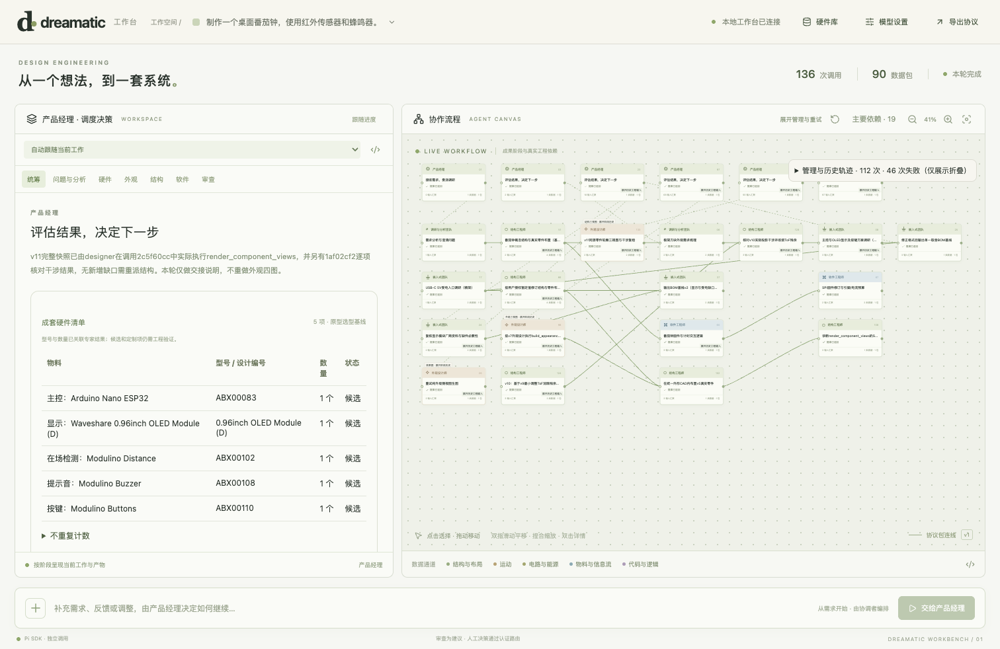
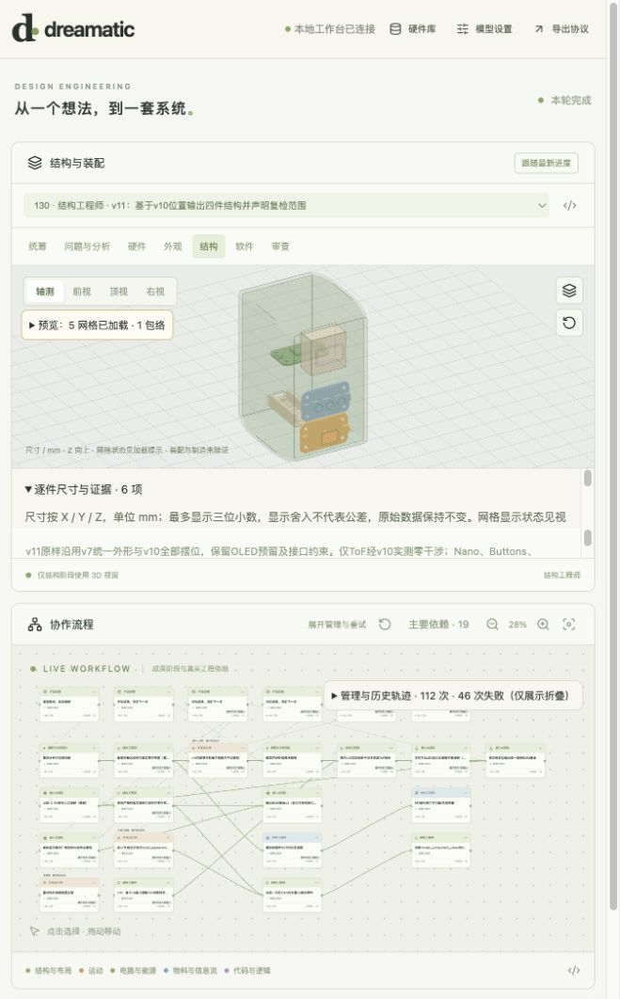
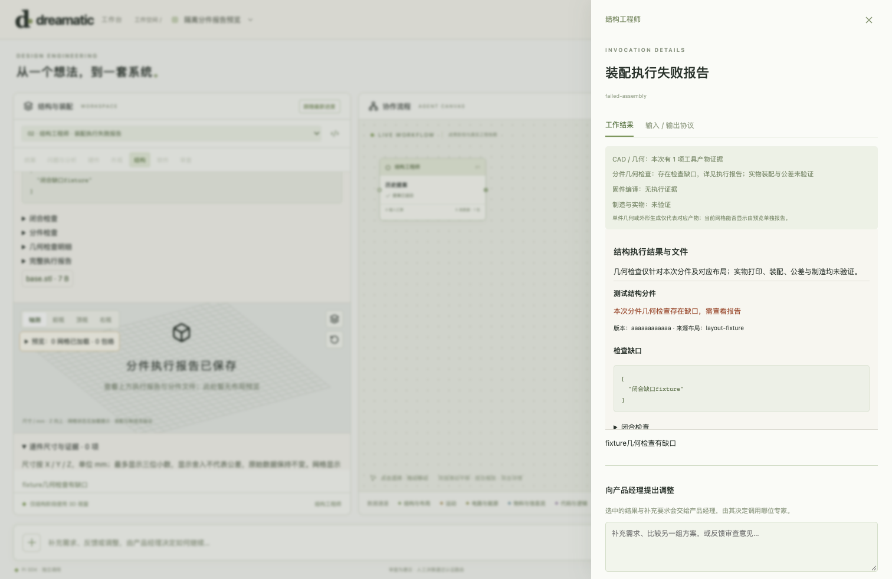
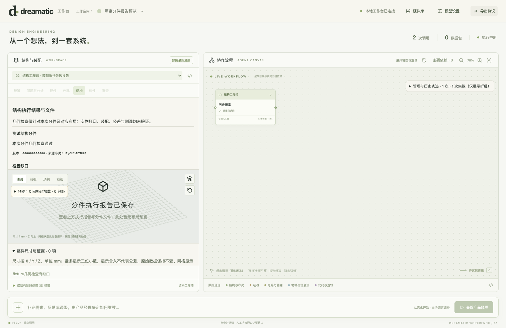
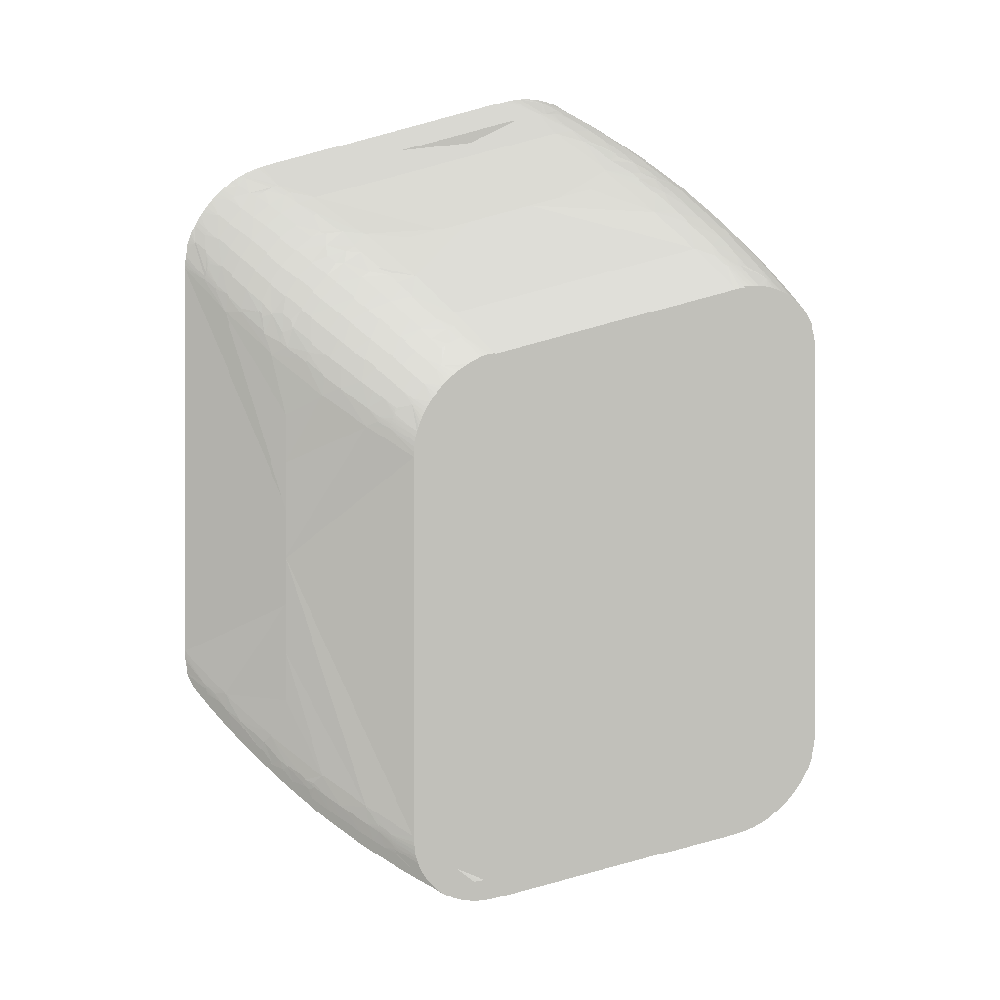
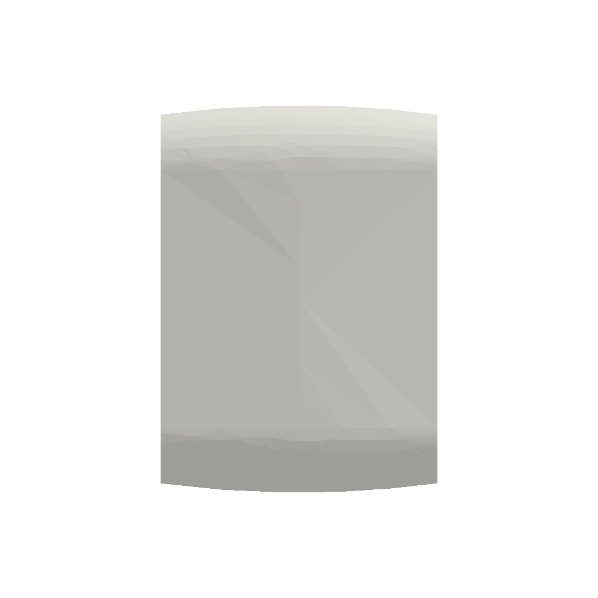

# Dreamatic Agent Workbench · 轻量检查点

2026-10-29。本版保留可运行源码、测试与截图；不上传硬件数据库、STEP/STL、工程项目、会话、认证文件、模型密钥、依赖目录、构建产物或完整日志。几何文件及运行记录仍保留在本地。

## 先看截图

### 流程总览：经理、分析师、三个外观成果阶段



只读载入既有番茄钟136次调用的截图，默认显示24块/19线，可展开历史；隔离测试使用fixture硬件库，截图不证明该环境加载了真实硬件网格。完整项目未随Git上传。

### 本机真实结构预览



现有v11历史结果：5网格加载、1估计包络；保留OLED厚度/连接器等未知。不是本轮重新生成或打印的整机。

### 装配报告：失败和成功都保留





以上两张为隔离UI夹具，验证报告、证据边界与安全下载展示；不把fixture下载当真实CAD执行。真正CAD工具另以合成几何夹具执行下述检查。

### 同一CAD生成的外观视图



|正视|俯视|侧视|
|---|---|---|
||||

推送前实际执行的合成外形smoke，从同一参数化CAD渲染，不是产品效果图或用户番茄钟。

## 推送前测试结果

|验证|结果|
|---|---|
|`npm run check`|通过|
|`npm test`|192通过 / 0失败|
|`npm run build`|通过；保留既有大chunk提示|
|`npm run test:workbench:ui -- --history`|通过：认证、卡片、依赖/历史、单端口、触控板平移/捏合、移动端、网格失败恢复|
|`node --import tsx scripts/test-workbench-assembly-ui.ts`|通过：失败报告可选、受限下载、证据展示、旧节点兼容|
|`workers/workbench/test_assembly.py`|真实工具链通过：双分件/定位销孔/螺钉柱、STEP回读、声明打印床；走线/连接器占用、撞壳、小床、短螺钉及定位反例拒绝|
|`workers/workbench/test_appearance.py`|真实工具链通过：外形、圆角越界/干涉拒绝、同尺度投影和凹轮廓|
|`workers/workbench/test_appearance_features.py`|真实按钮/接口及ShapeList重叠开孔路径通过；无效开孔拒绝|

机器可读摘要、环境版本及截图SHA-256见[results.json](results.json)。完整日志仅保留本地；本轮不调用付费模型。测试不证明实物打印、装配、受力、公差或固件编译/烧录通过。

## 启动与复测

```sh
npm ci
npm run build
npm run workbench
```

打开终端显示的本地链接，密钥在本机模型设置填写。硬件源库通过`WORKBENCH_LIBRARY_ROOT`配置；几何Python通过`WORKBENCH_GEOMETRY_PYTHON`配置，需build123d/OCP/numpy/trimesh/matplotlib。可用现有`npm run setup:cad`安装锁定工具链，再指定本仓库`.venv/bin/python`；首次安装需网络，本轮未重新执行安装。默认开发目录是本机相邻CAD目录，其他电脑必须调整。

普通UI夹具测试不需要真实模型API或硬件库；`--history`需要本机原有历史快照，不是本仓库自带的测试项目。浏览器回归使用标准macOS Chrome路径。

```sh
npm run check
npm test
npm run build
npm run test:workbench:ui
node --import tsx scripts/test-workbench-assembly-ui.ts
# 以下使用已经配置好的几何Python；输出放临时目录，不提交工程文件
python workers/workbench/test_assembly.py /tmp/dreamatic-assembly
python workers/workbench/test_appearance.py /tmp/dreamatic-appearance
python workers/workbench/test_appearance_features.py /tmp/dreamatic-features
```

## 仍需解决的点

- 当前主图隐藏节点时没有接续完整折叠关系，一些块看起来断头断尾。已整理[现有调用和数据流](call-logic.md)，本次按用户要求先保留现状，没有继续改调度。
- 三类外观主卡是历史产物归类，不表示旧136次调用被重写成三个新任务。
- 外部硬件数据和本轮爬取新增记录不随Git分发；没有自动导入替换正式库。
- 结构工具验证声明范围的名义几何；材料收缩、支撑、实测公差、螺纹强度、实际线束/连接器/工具可达性仍未验证。

更多接口说明：[工作台](../../agent-workbench.md) · [五类工程协议](../../workbench-engineering-protocol.md) · [硬件库](../../workbench-hardware-library.md) · [图像](../../workbench-images.md) · [装配](../../workbench-assembly-design.md)。
