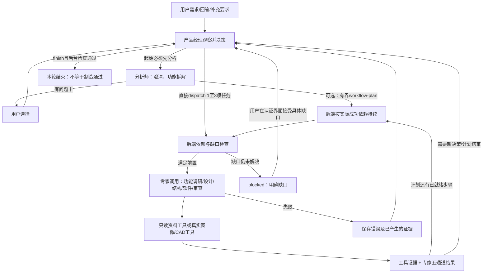
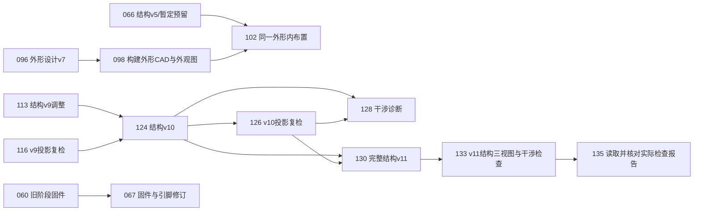

# 现有调用与数据流说明

核对日期：2026-10-29（台北）。本次仅做只读分析和文档导出，没有修改应用逻辑、画布、模型设置或运行项目。

先看结论：现在的主图确实会把有依赖的块画得像断开了。这主要是显示规则丢失了关系表达，并不意味着所有数据真的没传过去。另一些断尾是历史分支已被放弃，或者只交给经理观察；它们不应和最终成果混在一起理解。

本文分开说明三件事：当前代码怎样调度；当前番茄钟实际上怎样运行；当前画布怎样删减这份运行记录。当前项目是旧流程产生的136次调用记录，不能用现在的新规则反推它当时只有三个外观调用。

## 1. 先区分四种“关系”

|关系|记录在哪里|表示什么|不表示什么|
|委派|经理decision.tasks；被派专家node.inputs中包含经理ID|谁决定启动这次专家工作|经理的全部历史都应传给该专家|
|工程依赖|任务dependsOn；专家node.inputs中的专家ID|本次工作明确依赖哪些已成功结果|只会收到连线另一端那一个包|
|经理观察|经理node.inputs|经理读取已有结果、错误、取舍和执行证据，再决定下一步|这些上游彼此有工程依赖|
|条目/资产引用|packet.inputs、item.references、geometryRef、appearanceRef等|具体数据包、元件、外形版本与文件的引用|右侧流程图已经画出了每个条目引用|

右侧是“调用记录图”，不是电路连线图、装配连接图或完整数据血缘图。五类结构/运动/电路能源/信息流/逻辑数据装在packet里面，当前画布没有逐项画出这些领域内的连接。

## 2. 当前代码的调度机制

下图说明现有调度机制，不是硬编码的产品流水线。



- 产品经理不能递归派另一个产品经理；dependsOn只能用实际已成功专家的调用ID。
- 分析师可以提出最多12步的有界计划；后端每批最多启动3个就绪任务。计划接续不是每一步再调用经理，也不伪造经理节点；此时专家可以没有直接经理输入。
- 缺口会返回经理，超过有界处理次数则暂停。用户可通过认证界面带具体缺口继续，但不会把未知变成已验证。
- 同阶段同工程输入的重复视觉/诊断派工有止损；失败重试有次数和依据要求。它不是对任意历史节点的自动合并。
- 独立审查按需运行，建议可不采纳；它不批准项目，也没有“每个专家旁边必配一个审查者”的规则。

### 每种专家当前接什么、产出什么

|角色|输入/依赖|主要产物|实际工具与边界|
|产品经理|需求、选择、补充、已有结果/错误/执行证据、缺口|dispatch / finish / blocked|后端验证决策；不能批准未知风险或凭文字创造CAD|
|分析师|用户意图、回答、相关已完成资料|问题卡、需求/功能分析、可选有界计划、外观要求|可用硬件只读研究工具；不是每条需求固定套模板|
|嵌入式团队|拆解出的某个功能及相关资料|候选元件、来源、接口、BOM条目/基线、电路/信息关系与未知|hardware_search/get/document/inspect_geometry；资料来自库，缺失保留|
|外观设计师|外观需求、选型/布局及对应版本|概念效果、appearance-design、同源外观四图、结构轮廓三视图|概念生图；build_appearance_geometry；render_component_views。后两者是实际几何，不等同独立图片模型|
|结构工程师|成功硬件与外观结果，真实几何、完整布局|完整组件布局；assembly-design；执行后的分件证据|布局投影、build_printable_assembly；工具锁定来源/完整实例/姿态，预留未知不能冒充真实零件|
|软件工程师|结构阶段及型号/接口约定|程序、固件、类型化I/O和绑定、未验证事项|当前文本/协议产物不等于已编译/烧录|
|独立审查者|被指派范围的实际资料与结果|带引用的建议/风险意见|建议性输出，不是审批|

只读硬件研究工具当前并非只开放给某一个角色。资料库和CAD/图片执行器是工具/数据源，并不各自构成一块独立agent。

### 专家实际收到的数据比屏幕上的线更多

后端invoke的输入汇集是：

```text
本次输入包 = 用户原始需求
           + 历次选择
           + 用户补充要求
           + 项目级已附加硬件资料
           + 本次成功工程依赖及其成功祖先的结果/工具证据
           + 本次显式附加包
           + 可复用且匹配本次请求的已生成图片
```

专家追溯成功工程祖先时遇到经理会停止，避免把经理看过的一切都递归塞给专家。经理本身会观察很多已有结果。提示词还有压缩/索引预算，专家可用workbench_read_result读取本次实际输入内的完整条目；索引不是新数据，也不是全库任意读入口。

node.inputs是调用ID；packet.inputs是数据包ID；item.references是条目ID。三个层级不一样，当前画布主要依据第一层作图，因此它不是完整的数据流可视化。

## 3. 当前番茄钟的实际情况

只读项目：2ff5d77f-9ee5-4b07-a73d-ce25c50c7ea2，phase=complete。快照SHA-256：774be17f49704eb16766fc6a61f34fdefb694c16e168dbdd7194bb5c5fd17bf2。

|指标|实际值|
|调用记录|136：经理68、分析师2、嵌入式17、外观30、结构16、软件2、审查1|
|失败记录|46；历史失败没有被改写成成功|
|全部node.inputs关系|3907，其中经理观察3739、经理委派68、专家间数据依赖100|
|默认主图|24块、19条线，隐藏112块|
|只对这24块打开全部线|87条；仍不能恢复隐藏的112块及其线|
|找不到对应节点的输入ID|0|
|主图完全没有入线也没有出线的块|136号最终经理；实际有97个观察输入，显示时全部隐藏|

3907不是3907次模型调用，也不是3907条工程线；绝大多数是经理反复观察历史的记录。136是应用调用记录数，也不应直接等同网关HTTP请求次数或token计量。

### 末段实际数据链：把被隐藏的关键节点放回来看

下面每条箭头都是原始node.inputs中的直接关系；仅选取与末段成果相关的子图，省略其他依赖不表示它们不存在。这里暂不画经理观察/委派。



注意：067软件是较早的独立分支；130/133并没有再交给新软件调用。不能仅因最后phase=complete就说固件已基于最终v11重新生成、编译或烧录。新装配能力也没有被回填进这份旧记录，本项目没有新assembly执行节点。

## 4. 为什么画布出现断头断尾

|现有显示规则|现在的结果|容易造成的误读|
|先挑未被成功专家消费的成功分支、活动任务，再加一层直接输入|一些早期成功分支长期留在主图；不是只展示一个最终版本|旧BOM、旧诊断像当前必须继续的流程|
|外观按实际图片类型，各选最后一个产物调用；再删除其他designer节点|保留三种成果，但替换后没有再次补齐它们的直接输入|保留133结构图，却把直接来源130结构布局藏掉|
|主要连线模式隐藏所有指向经理的观察线|最终经理136完全孤立；中间经理也没有入线|经理没有看结果、没有参与|
|先过滤出可见节点，再计算连线|连到隐藏节点的边直接消失，不绘制折叠路径、汇总节点或隐藏数量标识|工程关系真的中断|
|主要模式额外去掉可由其他可见父输入间接到达的重复边|部分直接输入不再单独画线|输入比块脚注数量少|
|经理独立排一行，工程分层只计算可见专家依赖|隐藏祖先后，原本后期的块可能被放到第一列|像没有前置输入的起点|

具体例子：

- **133的工程输入130被隐藏。** 主图只剩132经理→133，看起来结构图没有结构来源。真实输入是132、130。
- **098的设计输入096被隐藏。** 主图容易看成经理097直接产出外形CAD；实际先有096设计。
- **124的工程输入113、116都被隐藏。** 它在主图没有入线，实际上依赖经理123及两个工程结果。
- **128还有入线124，但另一个工程输入126隐藏，且经理观察出线也隐藏。** 它看起来断尾，并不说明经理没收到诊断。
- **136最终经理的97个观察输入全部不画。** 在数据中不是孤块，在主图是孤块。
- **026被显示为“效果图”阶段代表，但其实际标题是重试侧视图。** 这是历史产物按图片类型归类，并不代表新的三个整洁任务已在这次旧运行中重新执行。

所以这里既有可接受的历史/终点节点，也有当前折叠策略造成的关系表达缺失。不能笼统地说“全都没关系”，也不能说“只是少画几条线而完全没问题”。这次先将现状列清，不继续修改。

## 5. 默认24块：逐块查输入和输出

“主图画出的输入/输出”按默认19条线统计；“被隐藏节点”按原始直接输入统计。经理的观察输入单独处理。编号与浏览器调用编号一致。

|编号 / 角色任务|主图画出的输入|原始输入中被隐藏的节点|主图画出的输出|实际直接工程下游（不含经理观察）|
|---|---|---|---|---|
|001 产品经理：接收需求，委派调研|—|经理观察0项被藏入历史|002|—|
|002 调研与分析团队：需求分析与澄清问题|001|—|006|004、005、006|
|003 产品经理：评估结果，决定下一步|—|经理观察0项被藏入历史|006|—|
|006 调研与分析团队：极简方块外观需求梳理|003、002|—|008|008、009、045|
|008 嵌入式团队：主控与OLED显示及按键方案调研（重试）|006|007、005|025|012、013、021、025、049|
|017 嵌入式团队：USB-C 5V受电入口调研（精简）|—|014|025、037|021、025、035、037、049|
|023 产品经理：评估结果，决定下一步|—|经理观察12项被藏入历史|024、025、026|—|
|024 嵌入式团队：复核显示模块厂商资料与缺件必要性|023|016|037|028、031、033、035、037、049|
|025 嵌入式团队：修正格式后输出单一取舍BOM基线|023、008、017|—|—|028、031、033|
|026 外观设计师：重试纯外观侧视图生图|023|015|—|029、039|
|037 嵌入式团队：输出BOM基线v2（显示与受电缺口复核，最小依赖）|024、017|036|—|039、040、042、043、045、046|
|051 结构工程师：番茄钟概念结构与真实零件布置（基于BOM v3）|—|050、049|060|055、056、059、060、062|
|060 软件工程师：番茄钟固件与计时交互逻辑|051|058、049|067|067|
|066 结构工程师：按用户授权暂定值修订结构与零件布置（v5）|—|065、062|102|070、071、073、075、079、081、102|
|067 软件工程师：SPI固件修订与引脚/电流预算|060|065|—|071|
|097 产品经理：评估结果，决定下一步|—|经理观察53项被藏入历史|098|—|
|098 外观设计师：按v7外观设计执行build_appearance_geometry|097|096|102|102、106、108|
|102 结构工程师：在统一外形CAD内布置v5真实零件|098、066|101|108|104、106、108、110、113|
|108 结构工程师：诊断render_component_views的ShapeList错误来源|102|107|—|—|
|124 结构工程师：v10：基于v9最小调整ToF消除残余干涉|—|123、113、116|128|126、128、130|
|128 结构工程师：核对v10实际投影干涉并收敛ToF残余|124|127、126|—|—|
|132 产品经理：评估结果，决定下一步|—|经理观察72项被藏入历史|133|—|
|133 外观设计师：v11同源零件轮廓三视图与干涉复检|132|130|—|135|
|136 产品经理：评估结果，决定下一步|—|经理观察74项被藏入历史|—|—|


## 轻量发布范围

上述分析为只读快照，已核对136次调用、3907条有效端点关系、默认24块/19线。完整逐次历史表和CSV仍保留在本地，本检查点不重复上传大量运行记录。应用调度和画布逻辑没有因本次整理而改变。
