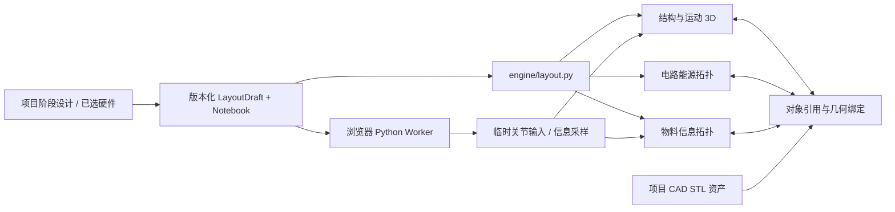

# 设计工作台：布局、关系与逻辑实验

本轮将项目的 CAD 工作台接入 `engine` 0.4.0 的 `layout_draft` v1 接口。主入口仍是项目内的「CAD 工作台」，打开后直接展示设计视图，不要求先完成外壳参数确认。已有 CAD 生成、候选模型和交付文件放在结构视图的「CAD 几何与构件映射」中。

## 视图与使用方式

| 视图           | 当前操作                                                                      | 检查范围                                                     |
| -------------- | ----------------------------------------------------------------------------- | ------------------------------------------------------------ |
| 结构           | 添加包络元件、拖动/旋转刚体、输入毫米位置和尺寸、导入 STL、映射 CAD 构件      | 当前姿态的包络重叠；实际 STL 使用网格碰撞后端                |
| 运动           | 同一装配的关节滑杆、数值输入、播放/暂停/重置、传动从动关系                    | 树状机构正运动学、旋转传动比、丝杆导程；可检查 13 个离散姿态 |
| 电路与能源     | 元件—端口—网络拓扑、拖动节点、端口和连接编辑                                  | 引用、领域、必要连接、角色冲突与声明路径连通性               |
| 物料与信息流动 | 合并拓扑；物料实线、信息虚线，可筛选图层                                      | 方向、介质/数据类型、必要连接与声明路径连通性                |
| 代码与逻辑     | Python 代码单元、输入滑杆/数值、运行到指定单元、日志、JSON/数值曲线、输出绑定 | 实际浏览器 Python 执行；输出只驱动临时运动预览或信息端口采样 |

拓扑节点、端口、连线、问题条目以及 Notebook 输出绑定通过同一份 `bindings` 映射高亮 3D 刚体。有物理端口姿态时显示黄色定位点。没有几何的实体显示辅助线框占位，并明确列为碰撞检查未覆盖对象。

建议流程：添加或导入元件 → 布局 → 编辑关节/端口/连接 → 保存草稿 → 分别检查碰撞、运动和连通。高级锚点、端口类型、内部路径等仍通过「布局 JSON 与导入」编辑。载入示例或完整 JSON 会替换当前未保存布局；STL 组装会追加带独立命名空间的实体，保留已有元件。导出 JSON 同时包含布局与 Notebook 文档。

## 建模与检查分离

`engine/layout.py` 提供独立的编辑契约。字段、数值、形状、姿态、标识符和规模必须符合 schema；重叠、断线、缺少引用目标、未定义轴线和闭环机构不阻止投影与保存。这些问题由检查或运动请求报告，不经过原有完整编译/仿真流程才允许显示。

- `layout_project`：返回规范化草稿、同一快照的 3D 场景、两个拓扑投影与跨视图映射。
- `layout_motion`：运行可处理的独立机构。无效机构保留布局姿态，其余机构继续预览。从动关节不能独立覆盖。
- `layout_collision`：检查布局姿态，或指定运动输入后的姿态。缺几何/缺网格依赖/无效机构均保留未覆盖说明；空结果不自动等于完整通过。
- `layout_connectivity`：只检查显式端口和连接。不会因为两个端口属于同一元件而推断内部导通。
- `layout_import`：将已有 bundle、AssemblyDesign 或 layout_draft 转为编辑草稿。保留旧源记录及旧快照语义。

数据层使用米、弧度和 `[x,y,z,w]` 四元数；界面按毫米、角度显示。实体、刚体、几何、端口、连接、关节和传动使用跨集合唯一引用。`snapshot_id` 标识布局，`pose_id` 区分同一布局的运动姿态。滑杆/代码改变预览不会写入已保存的布局姿态。



## 项目 API 与持久化

| 方法 | 路由                                  | 请求/用途                                                                       |
| ---- | ------------------------------------- | ------------------------------------------------------------------------------- |
| GET  | `/api/projects/:id/design`            | 当前阶段、上下文指纹、草稿版本、来源和是否过期                                  |
| POST | `/api/projects/:id/design`            | `{contextKey, baseRevision, draft, notebook}`；语法验证后保存                   |
| POST | `/api/projects/:id/design/operate`    | `{contextKey, method, draft?, source?, scenario?, joint_inputs?}`；上述五种操作 |
| POST | `/api/projects/:id/design/cad-assets` | 验证并导入项目实际 `base.stl` / `lid.stl`，返回装配坐标                         |
| POST | `/api/projects/:id/engine/cancel`     | 取消当前引擎进程                                                                |

草稿保存在当前阶段的 `designWorkspace`，含修订号、布局、Notebook 文档和来源指纹。未保存的浏览器编辑、滑杆状态、检查结果与 Notebook 输出不持久化。下游阶段继承上游 Notebook 文档，物理模型从该阶段正式设计导入；CAD 阶段可追加和编辑新增构件；修改已确认的硬件布局需要先重新打开结构阶段，固件阶段仅编辑逻辑实验。

读写沿用项目的 host/origin 校验和串行存储队列。保存检查上下文与草稿版本；检查完成时再次校验上下文，前端也丢弃已过期的姿态结果。项目正在执行工程任务时，浏览器编辑请求不会并发改写该任务的输入。草稿保存清除旧审阅并进入输入哈希，但不会批准阶段、生成 BOM 或声明已制造。

应用代理新增 `engine_workspace` 读写工具，仍由当前角色/阶段/版本约束；reviewer 只读。物理草稿与正式 `engineDesign` 不一致时标为 `pending`。代理需读出草稿并用已有 `engine_layout` 表达它，提交后由 `engine_verify` 比较实际导入的布局快照，再运行原有验证；仅生成一个候选设计不能清除此状态。对于尚不能用原有执行契约表达的草稿，继续作为设计草稿保留，不伪造验证通过。审批仍只发生在原来的应用路由。

## CAD 映射

继续使用项目所属、SHA-256 固定的 STL 资产，无任意文件路径解析。上传的 STL 保留原始坐标与显式单位。绑定可新建 CAD 刚体，或替换一个既有刚体的 solid 几何，保留它的端口与关节引用。

当前外壳生成器的底座使用原点，上盖使用绕 X 轴 180° 加外壳高度的装配姿态。将当前 CAD 构件绑定到已存在刚体时，转换为该刚体局部坐标，保留原装配位置。普通上传资产按刚体局部原点放置。绑定同一资产到多个刚体不会覆盖彼此的几何记录。

这实现了工作台与已有 CAD 管线的几何关联。任意 engine 元件布局不会自动生成通用 CAD 参数实体；当前项目的模板外壳生成能力仍按已有参数和工程约束工作。

## Python 逻辑实验

依赖固定版本 `pyodide@0.29.3`，由应用服务器提供本地运行时资源，首次运行加载 WASM/标准库。没有外部 CDN 或服务器 Python shell 执行。每次从头创建独立 Worker，可以运行至某一单元；变量通过依次执行的单元共享，不保留跨次执行的隐藏内核状态。

代码获得三个变量：

```python
# inputs：滑杆/数值；snapshot：当前布局 JSON 的副本；outputs：可序列化输出
angle = inputs["angle_deg"]
outputs["angle"] = angle
outputs["curve"] = [i * angle / 20 for i in range(21)]
print("目标角度:", angle)
```

在「输入控件与输出绑定」中，例如配置 `{ "output": "angle", "target": "servo/joints/axis", "unit": "deg" }`，可驱动舵机示例的关节。旋转支持 `rad/deg`，直线支持 `m/mm`，信息端口支持 `sample`。单位不匹配不会写入运动输入。Notebook 结果不作为工程验收或固件执行证据。

Worker 响应有独立 CSP，只允许加载指定本地 Python 静态资源，阻止项目 API、外网及子 Worker；不提供宿主文件系统或应用凭据。每次最多 16 单元、每单元 20,000 字符、输入快照 1 MB、日志 50,000 字符、结果 100,000 字符，30 秒超时终止，支持手动取消。当前没有独立操作系统级内存配额，也不支持联网安装第三方 Python 包、`.ipynb` 内核会话或固件部署。

## 当前能力边界

- 检查几何包络而非制造公差。纯 primitive 后端对柱体/胶囊使用保守盒；STL 使用可选 Trimesh/FCL/Rtree 后端。辅助几何不是实体尺寸证据。
- 运动是声明式关节/传动预览，不计算力、惯量、扭矩、接触响应或闭环约束求解。
- 13 帧检查是同步驱动的一条离散轨迹，不覆盖全部关节组合，也不做连续扫掠碰撞。
- 电路/能源与物料/信息只做声明关系的连通检查，没有电流、功率、流量或协议仿真。
- 图节点位置是会话内的显示状态；编辑关节轴线和锚点、完整端口属性仍主要使用 JSON。
- 检查与 Python 输出当前是临时预览；正式证据继续由已有 `engine_verify` 和工程产物流程保存。

## 运行与验证

安装 Node 依赖后，配置 `MAKE_ENGINE_PYTHON` 为 Python 3.11+ 且含 Pydantic 2 的解释器；网格检查需要 `engine/requirements-mesh.txt`。应用启动方式不变：`npm run dev`，或 `npm run build` 后 `npm run server`。

```powershell
npm run check
npm test
npm run build
python -B -m unittest discover -s engine/tests -v
# 真实 Python / STL HTTP 与浏览器回归
$env:MAKE_ENGINE_TEST_PYTHON = '<engine Python 绝对路径>'
$env:MAKE_ENGINE_TEST_MESH = '1'
$env:MAKE_TEST_BROWSER = '<Chrome 或 Edge 可执行文件绝对路径>'
npm test
npm run test:ui:engine
```

测试覆盖布局与检查分离、无效机构隔离、传动、断线/类型/方向、占位未覆盖、快照与姿态、旧格式导入、保存冲突、CAD 网格映射、正式设计对齐，以及浏览器中的真实 Python、取消、网络隔离和图/3D 高亮。
