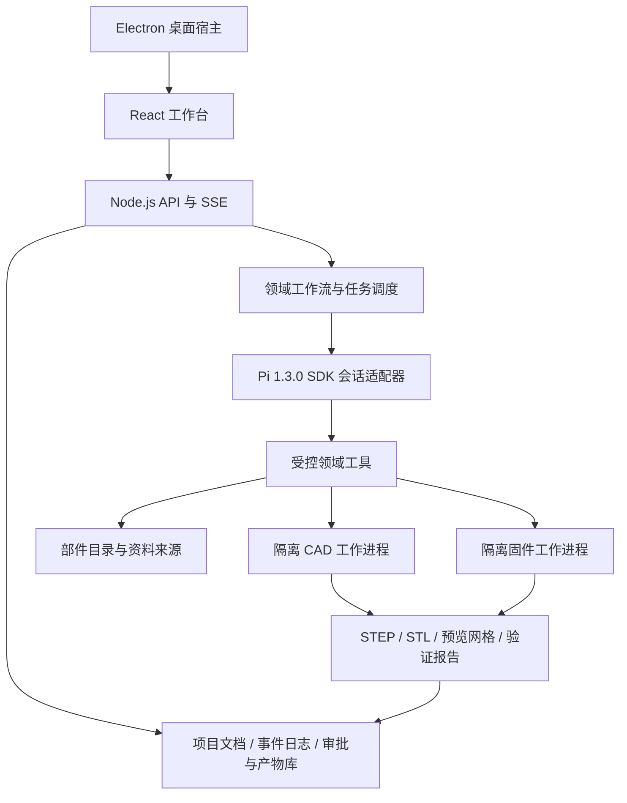

# DreamaticMake：智能终端产品设计系统方案

日期：2026-10-18 · 状态：初始设计基线；当前实现进展见 `implementation-status.md`

## 1. 产品定义

面向创客的本地优先智能终端设计工作台。用户描述产品想法，系统逐步澄清需求、对齐意图、选择已有开源硬件、设计外观和结构、生成可编辑 CAD 与可编译固件，最终交付可以采购、打印、装配、烧录和测试的原型项目包。

默认采用「现成开发板 / 功能模块 + 标准紧固件 + FDM 3D 打印外壳」。优先复用用户已有部件；优先选择资料完整、尺寸可信、开源许可明确的方案。首版不包含定制 PCB、自动采购和自动控制打印机。

首版闭环建议限定为低压 USB 供电的桌面智能终端：一个主控、少量传感器、显示或按键、分体打印外壳。电池、大功率执行器、多板复杂装配作为后续能力扩展。完整产品目标保持覆盖需求中列出的全部阶段。

交付状态分别记录「软件构建通过」「工程检查通过」「用户确认」「实物验证通过」。前三项完成不能自动推断实物已通过测试。

## 2. 已核实的代码基础与版本

参考仓库：`/Users/nancao/Projects/Dreamatic`；目标仓库：`/Users/nancao/Projects/DreamaticMake`，调研时为空目录。

| 现有实现                                | 证据位置（相对 Dreamatic 仓库）                                                                        | 本项目处理方式                         |
| --------------------------------------- | ------------------------------------------------------------------------------------------------------ | -------------------------------------- |
| React 三栏工作台、项目导航、画布        | `apps/web/src/App.tsx`、`components/Sidebar.tsx`、`components/Canvas.tsx`                              | 提取布局与视觉语言，替换工作区内容     |
| 深色侧栏、暖灰画布、橙色与黄绿强调      | `apps/web/src/styles.css`                                                                              | 继承设计变量，提升正文和工程数据可读性 |
| 对话、工具过程、运行状态                | `components/AgentPanel.tsx`、`components/RunStatus.tsx`、`workflow-live.ts`                            | 改造为带审阅卡片的对话与阶段导航       |
| `.env` 字段表单、秘密字段掩码、原子保存 | `components/SettingsModal.tsx`、`apps/server/src/config-store.ts`                                      | 复用模式，扩展 CAD、固件、打印配置     |
| HTTP/SSE、项目和会话存储、导出          | `apps/server/src/index.ts`、`session-registry.ts`、`run-store.ts`、`project-export.ts`                 | 按模块迁移，保持项目间事件隔离         |
| Pi SDK 接入、扩展、Context 和审批绑定   | `packages/design-agent/src/runtime.ts`、`extension.ts`、`context-authoring.ts`、`workflow-contract.ts` | 借鉴契约，新增工程领域模块             |
| Electron 桌面宿主                       | `apps/desktop/main.mjs`、`preload.cjs`                                                                 | Web 闭环后接入桌面打包                 |

Dreamatic 当前 `packages/design-agent/package.json` 锁定 Pi **0.85.1**；其 README 明确工程 CAD 尚未实现。因此不能直接复制旧运行时并假设工程能力已经存在。

截至本次调研，GitHub 最新发布为 **Pi v1.3.0**。本项目初始锁定 `@earendil-works/pi-coding-agent: 1.3.0`，提交依赖锁文件；不以 main 分支作为发布基线。后续升级通过适配测试单独进行。[Pi 发布页](https://github.com/earendil-works/pi/releases/tag/v1.3.0)；[该版本包定义](https://github.com/earendil-works/pi/blob/v1.3.0/packages/coding-agent/package.json)。

采用 Pi SDK 管理会话、模型、工具和流式事件，工程流程与用户审批由 DreamaticMake 实现。SDK 的 MCP 能力需要显式装配，不能假设 CLI 默认扩展也在 SDK 会话中启用。[v1.3.0 SDK 文档](https://github.com/earendil-works/pi/blob/v1.3.0/packages/coding-agent/docs/sdk.md)。

## 3. 核心工作流与预览

| 阶段       | 系统工作                                             | 必须展示的中间结果                                                        | 用户确认后冻结的内容                   |
| ---------- | ---------------------------------------------------- | ------------------------------------------------------------------------- | -------------------------------------- |
| 需求分析   | 场景、对象、功能、预算、交付要求、已有硬件、打印条件 | 结构化需求卡、验收清单、待回答问题、假设                                  | requirements 版本                      |
| 意图理解   | 将需求转成产品行为、交互、尺寸和设计取舍             | 产品定义、关键使用流程、风格参考、必须/可选功能、取舍说明                 | intent 版本                            |
| 硬件选型   | 检索候选、核验资料、比较成本与兼容性、确定布局边界   | 2–3 个可行方案或说明候选不足；BOM、引脚表、接线图、尺寸与来源、兼容性检查 | BOM、电气接口与部件几何版本            |
| 外观设计   | 根据部件包络和交互布局设计候选外形                   | 通常 2–3 个方向、正侧背视图、尺寸包络、接口位置；标明概念图性质           | 外观方案与尺寸约束                     |
| 结构设计   | 部件布局、固定方式、壳体分件、螺柱、连接器和装配空间 | 透明壳体、爆炸图、剖面、尺寸标注、紧固件、装配顺序、冲突列表              | 装配布局与机械参数                     |
| CAD 建模   | 参数化建模、实体与网格验证、打印检查                 | 可旋转模型、零件树、剖切、关键尺寸、打印方向、检查报告、下载              | CAD 源码及输出文件哈希                 |
| 固件开发   | 根据已确认功能和引脚表编写驱动与产品逻辑，构建验证   | 文件变更、配置摘要、编译日志、资源占用与测试结果                          | 固件源码与构建版本；烧录前单独确认设备 |
| 交付与验证 | 汇总采购、打印、接线、装配、烧录和测试材料           | 交付目录、完整性检查、实物测试清单、已知限制                              | delivery 版本                          |

前六阶段均必须等待用户确认。未确认时可以保存草稿，但不能执行依赖该确认的后续生产任务。固件任务在硬件与行为冻结后技术上具备启动条件；首版采用顺序执行，便于定位问题，后续再支持与机械任务并行。

每张审阅卡提供「确认并继续」「提出修改」「查看差异」，多方案时先选方案。确认前始终展示采用的假设和仍未核实的数据。用户在普通对话中提出修改时，生成明确变更请求并更新预览，再确认新版本。

若硬件尺寸或安装孔位缺失，使用明确标注的临时包络继续探索，但阻止精确结构/CAD 的最终确认，直到取得资料或用户提供实测数据。用户确认审美选择不能覆盖失败的工程必检项。

## 4. 用户界面

沿用 Dreamatic 的暖灰背景、深色项目侧栏、橙色主操作和黄绿状态强调。原始颜色可作为起点：背景 `#e8e7e1`、侧栏 `#20211d`、面板 `#f6f5f0`、主色 `#d76942`、强调色 `#c9e46b`。正文建议 14px 起，工程数据使用等宽字体；状态同时采用图标和文字。

```text
┌──────────────┬──────────────────────────────────┬─────────────────────┐
│ DreamaticMake│ 项目名称 / 版本       导出        │ 设计助手            │
│ 新建 / 搜索  ├──────────────────────────────────┤ 对话与执行摘要      │
│              │ 需求→意图→硬件→外观→结构→CAD→固件→交付               │
│ 项目列表     ├──────────────────────────────────┤ 当前步骤 / 等待确认 │
│ · 桌面终端   │ 概览 硬件 外观 结构 CAD 固件 文件 │                     │
│ · 环境显示器 │                                  │ 审阅卡 + 修改建议   │
│              │ 当前阶段预览 / 3D / 对比 / 报告   │                     │
│              │                                  │ 附件和引用标签      │
│ Settings     │ 版本与验证状态                    │ 多行输入框  停止/发送│
└──────────────┴──────────────────────────────────┴─────────────────────┘
```

桌面默认左侧约 240px，右侧对话约 420px，中间自适应；两侧可收起、拖动调整。窄屏使用「预览 / 对话」切换，阶段状态保持可见。

对话框参考 Codex 的交互模式：流式回复、简短执行更新、可展开工具记录、停止按钮、附件、引用项目文件/部件/模型对象、运行中补充指令、队列状态。用户可在 3D 中选中某个零件并发送「这里增加 USB 插头空间」。内部推理不作为执行日志展示。

运行中输入需区分「调整当前任务」与「排队下一条」。停止、刷新、切换项目后，对话和执行状态必须与后台一致，恢复时不重复执行已完成任务。

预览区：需求/意图用可读卡片；硬件用 BOM + 接线图 + 部件模型；外观用方案对比；结构/CAD 用 Three.js 显示从工程几何派生的网格，提供尺寸、隐藏、透明、爆炸和剖切；固件用代码差异与真实构建日志。Three.js 负责展示，工程精度由 CAD 工作进程验证。[Three.js 文档](https://threejs.org/docs/)。

项目管理包含新建、重命名、归档、恢复、搜索、版本历史、项目模板和导出。项目列表显示当前阶段与等待确认标记。上传支持需求文本、图片、数据手册、部件 CAD、已有代码；不同格式提供解析结果和失败反馈。

## 5. 阶段进度与确认机制

每个阶段状态为 `not_started / running / awaiting_confirmation / approved / failed / stale / skipped`。前六个必选阶段不可跳过；可选任务是否跳过由已确认范围决定。

顶部进度条按真实阶段状态推进，默认展示「已确认 3/6 个设计阶段，当前：外观待确认」。构建任务只有可测子任务才显示完成数量或百分比；不根据流逝时间伪造进度，不显示无法证明的 ETA。重开上游阶段时，进度反映受影响阶段失效，同时保留旧版本历史。

服务端持久化审批对象：

```ts
type ApprovalReceipt = {
  id: string;
  projectId: string;
  stageId: string;
  revision: number;
  inputHash: string;
  artifactHashes: Record<string, string>;
  decision: "approved" | "changes_requested";
  actorId: string;
  decidedAt: string;
};
```

工程验证通过后才能请求审批。审批接口必须校验当前版本、哈希和项目归属；重复提交使用幂等键，过期审批返回冲突并要求刷新。Agent 无权写用户审批回执。确认记录写入并持久化后，调度器才释放下一阶段任务。

变更按依赖传播：主控更换可能影响引脚、固件、包络与外壳；仅配色变化通常影响外观预览和交付说明。由结构化依赖图判断失效范围，保留未受影响的有效结果，避免全部重做。

## 6. 系统架构



建议采用 TypeScript monorepo。应用层借鉴 Dreamatic，工程工具链使用独立 Python/CLI 工作进程，避免 CAD 崩溃拖垮对话和服务。

```text
apps/web/                  React 工作台、对话、BOM、3D 与审阅
apps/server/               API、SSE、项目存储、设置和本地访问策略
apps/desktop/              Electron 宿主、工具链发现与打包
packages/agent-runtime/    Pi SDK 适配、会话与领域工具注册
packages/workflow/         阶段状态机、依赖、审批、恢复与幂等
packages/contracts/        Schema、事件、项目与工程数据类型
packages/hardware/         部件目录、来源、兼容检查、BOM 与引脚
workers/cad/               build123d 建模、导出、几何/打印检查
workers/firmware/          PlatformIO 构建、测试与设备适配
.pi/skills/                需求、选型、工业设计、结构、CAD、固件知识
catalog/                   经核验的首批部件记录与许可信息
docs/                      产品、接口、开发与验收文档
workspace/                 项目运行数据，不提交到源码仓库
```

首版采用一个主会话和按阶段切换的工具/知识范围。后续若引入多个专业会话，依然共享已提交工程契约，不依赖聊天转述同步设计参数。Pi 保持上游依赖，不复制运行时内部实现。

## 7. 硬件与工程数据契约

最关键的工程数据链是：需求/意图 → 硬件与接口 → 部件空间布局 → 外壳参数 → CAD → 固件与交付。机械、电子和固件必须引用相同部件 ID 与版本。

部件记录至少包含：厂商、精确型号、硬件修订版、来源链接、抓取日期、开源状态及许可证证据、数据手册/原理图链接、供电与逻辑电平、典型/峰值功耗、总线与地址、驱动支持、板框/器件高度、安装孔中心、连接器位置、插拔空间、天线净空、CAD 资产及其哈希、价格币种与时间、信息可信度。

将「开源硬件」「开源固件兼容」「资料公开但开源状态未核实」分开标注。搜索结果不直接成为已核验目录条目；搜索得到的候选经资料确认后才进入选型基线。型号相近的不同板卡不能共享未经核验的尺寸。

选型先执行硬约束过滤，再解释成本、开发难度、体积、文档完整度等排序理由。必检项包括供电、逻辑电平、引脚数量、引脚复用、I²C 地址、总线资源、接口方向、功耗预算与空间。BOM 同时包含线材、转接件、螺丝、螺母和打印材料估算。

统一几何约定：毫米、右手坐标系、装配坐标与部件局部坐标、明确变换矩阵。引脚映射同时驱动接线图和固件配置。尺寸字段记录来源与误差，连接器实体、线缆弯折和工具操作空间独立建模。

## 8. CAD、打印与固件方案

建议以 build123d 的 Python 参数化 BREP 建模为首版 CAD 主路径：生成可编辑脚本和参数文件，导出 STEP 作为交换格式，STL 作为打印输入，派生网格供网页预览。build123d 基于 Open Cascade，支持工程实体建模与导出。[项目文档](https://github.com/gumyr/build123d)；[导入导出文档](https://build123d.readthedocs.io/en/latest/import_export.html)。具体版本在 P0 工具链验证后固定，不直接跟随开发版文档升级。

采用「参数与装配契约 + 受控建模模板 + 必要时生成脚本」策略。首批模板包括上下壳、显示开窗、USB 开孔、按键孔、螺柱、传感器通风口。自由曲面等复杂造型后续扩展。

CAD 必检：实体有效、正体积、预期实体数量、关键尺寸、部件碰撞、安装孔与接口对齐、壳体间隙、网格闭合、单位与导出回读。打印检查分为可自动验证的几何项和需要切片/实测的工艺项；壁厚采样、悬垂提示等应显示检查覆盖范围，不能宣称穷尽所有缺陷。

打印配置记录材料、喷嘴、层高、打印空间、最小壁厚、配合间隙、孔补偿、支撑偏好与打印方向。间隙和壁厚来自所选配置，可通过试片校准，不将单一数值视为通用打印标准。交付包含打印方向和装配说明；切片时间/材料量只有取得实际切片结果才展示为测量值。

固件首版建议使用 PlatformIO + 一个经验证的 MCU 板卡/框架组合；构建配置、平台、库和工具链版本锁定。PlatformIO 提供板卡/框架配置和 CLI 构建路径。[官方介绍](https://docs.platformio.org/en/latest/what-is-platformio.html)；[pio run](https://docs.platformio.org/en/latest/core/userguide/cmd_run.html)。

固件从确认后的产品行为状态机与引脚契约生成。包含初始化、驱动、错误状态、配置、交互逻辑、日志和测试；构建通过与实物功能测试分别记录。编译错误允许有限次数修复；改变已确认的接口需返回审批流程。烧录需要用户选择实际设备，并确认目标与固件版本。

## 9. 数据、接口与执行可靠性

每个项目包含 `project.json`、版本化 `context/`、`events.jsonl`、`approvals/`、Pi `sessions/`、`sources/`、`cad/`、`firmware/`、`artifacts/` 和 `reports/`。业务状态来自版本化文档与事件，不从聊天摘要推断；Pi 会话保持其自身持久化格式。

API 首版草案：

| 接口                                          | 用途                            |
| --------------------------------------------- | ------------------------------- |
| `POST/GET /api/projects`                      | 创建、列举项目                  |
| `GET/PATCH /api/projects/:id`                 | 详情、重命名与归档              |
| `POST /api/projects/:id/messages`             | 对话，指定 steer 或 follow-up   |
| `POST /api/projects/:id/abort`                | 取消执行                        |
| `GET /api/projects/:id/events`                | SSE，支持事件游标重连           |
| `GET /api/projects/:id/stages/:stage`         | 阶段快照与当前预览版本          |
| `POST /api/projects/:id/approvals`            | 用户确认或修改请求              |
| `GET /api/projects/:id/artifacts/:artifactId` | 经清单校验的预览与下载          |
| `GET/PUT /api/settings`                       | 读取掩码配置、校验和保存 `.env` |
| `POST /api/diagnostics`                       | 检查模型、CAD 与固件工具链      |

统一事件信封包含 `eventId / projectId / runId / revision / sequence / type / timestamp / payload`。领域事件涵盖阶段变化、产物就绪、审批请求、审批记录、任务开始/进度/结束与错误；模型 token 和工具事件映射为用户可读过程。

每个项目串行更新，使用预期版本避免并发覆盖；任务具有幂等键、输入哈希、取消标志、超时和有界重试。服务重启将未完成任务标为中断，检查产物与回执后恢复，不重复烧录等设备操作。SSE 断开不等于任务取消。

外部脚本在受控工作进程执行，限制目录、环境变量、网络、进程时间和资源；单靠设置 cwd 不能建立隔离。Pi 的权限边界由宿主实现，P0 明确部署平台可用的沙箱方案和失败行为。设置写入与审批仅由服务端受信任路径执行，领域 Agent 不获得任意 shell、系统 `.env` 和密钥读取权。

## 10. Settings 与交付

Settings 模块：模型服务、图像服务、搜索与目录、CAD 工具链、固件工具链、打印机/材料、工作空间、语言与诊断。表单直接映射系统 `.env`，保留未修改行与注释；高级配置可查看脱敏的键值差异。

密钥读回仅显示是否配置，支持保留/替换/清除。保存前校验，临时文件原子替换并保留恢复点。每次运行绑定配置快照，普通设置在下一次任务生效，运行中不混用模型和工具版本；端口/工作目录等更改显示重启要求。原始含密钥 `.env` 不通过浏览器直接返回。

交付包包含需求与意图、来源和 BOM、接线与引脚、外观/结构说明、CAD 源码和参数、STEP、分件 STL、固件工程及构建产物、版本锁定信息、验证报告、装配/烧录/测试说明及许可证。导出通过白名单清单，不包含 `.env`、会话凭据和内部缓存。

## 11. 成功标准

用一个 USB 供电桌面传感显示终端完成演示：从自然语言建项目，到六次明确预览与确认，再到可重建 CAD、可编译固件和完整项目包。更换部件必须触发正确的失效与重验；刷新、重启和切换项目可恢复状态。

系统工程验收使用真实 CAD 文件和编译日志；最终原型验收还需打印、装配、烧录并测试选定实物。采购和打印等待不计入软件开发工作量估计。
