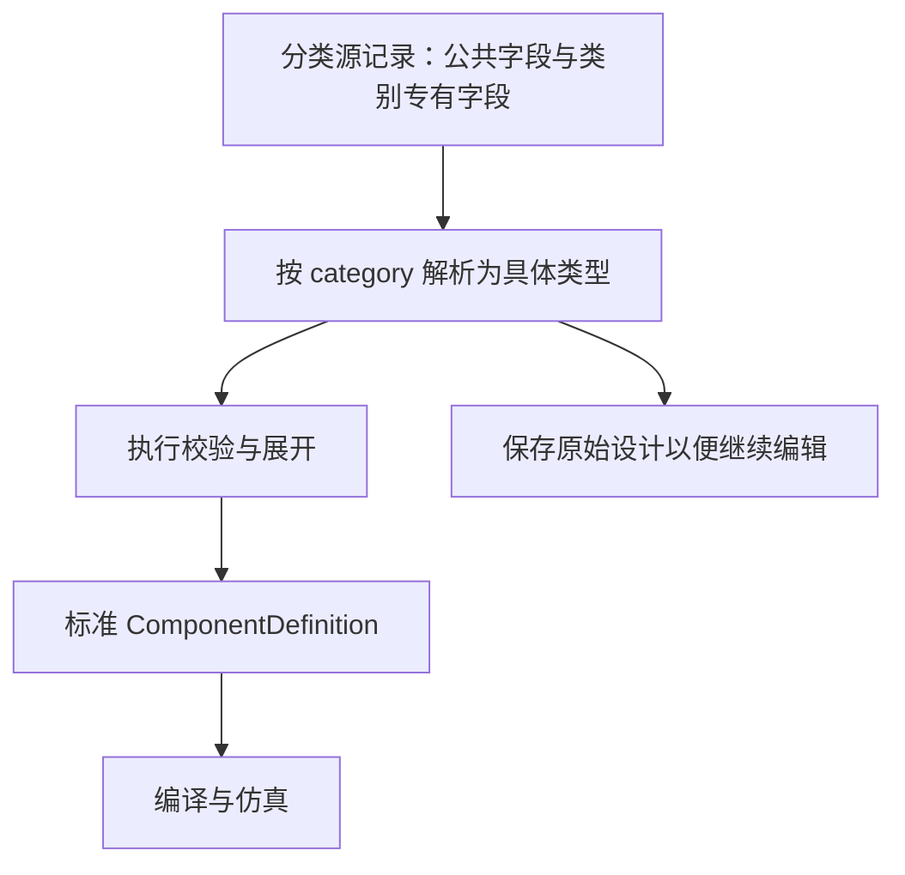

# 元件分类与结构化描述

更新日期：2026-10-22。依据当前 `engine/components/`、`engine/interface/` 与 `engine/schema/` 实现。引擎版本为 `0.3.0`，执行 DSL 为 `0.2.0-proposal`，分类设计版本为字符串 `"1"`。

本文专门回答：**当前有多少类元件，各类使用什么字段描述，以及这些字段如何进入标准模型与计算。** 整体编译、仿真及应用架构见[代码框架 v2](代码框架v2.md)。

## 1. 当前分为 14 类

准确类别以 [Component 判别联合](../../engine/components/__init__.py) 为准。每份分类设计只选择一个 `category`，解析器据此选择具体 Python 类型。

| 序号 | 类别 | `category` | Python 类型 | 主要描述什么 |
| --- | --- | --- | --- | --- |
| 1 | 结构件 | `structure` | `Structure` | 实体形状、碰撞包络、安装口 |
| 2 | 执行器 | `actuator` | `Actuator` | 被控制的运动自由度、驱动方式与运动限制 |
| 3 | 传动件 | `transmission` | `TransmissionComponent` | 关节约束、旋转比例、丝杆传动 |
| 4 | 发光元件 | `light` | `Light` | 单通道或多通道亮度命令 |
| 5 | 显示元件 | `display` | `Display` | 屏幕尺寸与文字显示命令 |
| 6 | 发声元件 | `sound` | `Sound` | 换能器种类与音调频率命令 |
| 7 | 人机输入 | `human_input` | `HumanInput` | 按键、编码器等用户输入的采样通道 |
| 8 | 传感器 | `sensor` | `Sensor` | 环境量或关节状态的测量通道 |
| 9 | 控制器 | `controller` | `Controller` | 主控平台、具名控制函数、接口及固件引用 |
| 10 | 驱动器 | `driver` | `Driver` | 驱动通道的声明式信号行为 |
| 11 | 电源 | `power` | `PowerSource` | 电源种类与理想输出电压 |
| 12 | 物料输送件 | `transport` | `Transport` | 气体、液体、颗粒的端口与内部通路 |
| 13 | 机械储能件 | `energy_storage` | `EnergyStorage` | 储能机制、容量、初始能量及被动关节 |
| 14 | 基础电路器件 | `circuit_element` | `CircuitElement` | 电阻、电容、电感、二极管、晶体管与光耦的规格和接线 |

这 14 类是当前**编写接口支持的分类**，并非所有真实元器件的完整分类学。`ComponentDesign`、`ElectricalDesign` 是公共基类；`ControlFunction`、`FirmwareSource` 是辅助结构；`AssemblyDefinition` 是组合容器，它们都不是额外的元件类别。

### 1.1 分类依据：主要实现机制与用途分开

`category` 表示主要实现机制，`roles` 表示在某产品中的用途，`functions` 描述能力。例如：

- 舵机带动指针显示天气，舵机仍是 `actuator`，用途可以是 `information_output`；指针是独立 `structure`。
- 扇叶虽会旋转，但如果自身没有内部运动自由度，仍可为 `structure`；相对机壳的旋转由执行器或装配关节描述。
- 电机提供受控运动，归 `actuator`；电机驱动板描述信号驱动，归 `driver`；水路归 `transport`。
- 弹簧归 `energy_storage`，声明储能不等于已经实现释能动力学。

多功能商品模块可通过标准 `ComponentDefinition` 描述多个领域，或在需要独立替换/选型时拆成总成中的多个真实子件。不要把同一个物理实体复制成多类元件，造成几何和数量重复。

## 2. 每类元件共享的结构

### 2.1 分类设计记录

公共字段继承关系为 `Contract → Definition → ComponentDesign → 具体类别`。电子类还经过 `ElectricalDesign`，增加公共接线字段 `wiring`。

| 字段 | 类型 | 必填/默认 | 含义 |
| --- | --- | --- | --- |
| `record_kind` | 固定字符串 | 默认 `"component_design"` | 区分分类设计与标准执行定义 |
| `dsl_version` | 固定字符串 | 默认 `"0.2.0-proposal"` | 执行契约版本 |
| `design_version` | 固定字符串 | 默认 `"1"` | 分类设计格式版本，不能写成数字 `1` |
| `category` | 各类固定字符串 | 通用判别入口必须明确给出 | 选择这 14 类之一；直接构造具体 Python 类时有默认值 |
| `id` | `Id` | 必填 | 定义标识 |
| `revision` | 正整数 | 默认 `1` | 定义修订 |
| `name` | 字符串 | 必填 | 可读名称 |
| `roles` | `Id` 数组 | 默认 `[]` | 产品中的用途标签 |
| `parameters` | `Id → Parameter` | 默认 `{}` | 设计参数、范围、已知/假设/未知状态 |
| `geometry` | `GeometrySpec` | 默认空结构 | 刚体、包络和显示资产 |
| `mounts` | `MechanicalSpec` | 默认空结构 | 安装端口 |
| `functions` | `Id → FunctionSpec` | 默认 `{}` | 声明的功能与输入输出 |
| `principles` | `Id → PrincipleSpec` | 默认 `{}` | 工作原理与行为引用 |
| `realizations` | `Id → Realization` | 默认 `{}` | 功能、原理和对象之间的实现映射 |
| `sources` | `Id → SourceRecord` | 默认 `{}` | 来源资料、网址/资产和定位信息 |
| `evidence` | `Id → Evidence` | 默认 `{}` | 厂商额定、假设、计算、测量或教程报告及条件 |

`Id` 以英文字母或下划线开头，后续可用字母、数字、下划线、点和连字符，最长 128 字符，不含 `/`。JSON 中序列写数组；Python 模型内部序列为元组，映射冻结。所有契约拒绝额外字段、错误类型和非有限数值。

本轮采用紧凑扩展：结构、传动、执行器、灯光、显示、声音、传感、电源各增加一个可选 `spec`；电源另增加可选 `wiring` 以描述实体接线位置。新增基础电路器件必填 `spec/wiring`。未填写扩展字段时，旧记录的序列化与快照哈希保持不变。

本节以后的字段表只列**该类专有字段和额外继承字段**，公共字段不再重复。结构示例都省略可使用默认值的公共字段；数值为说明结构的假设，不是厂商规格。示例可解析并编译，但实际运行仍需绑定快照的场景、输入与根刚体放置。

### 2.2 分类源记录如何进入统一模型



展开后统一为：

```text
ComponentDefinition
├── 身份、参数、功能、原理、来源和证据
├── physical
│   ├── geometry       ← 分类设计的 geometry
│   ├── mechanical     ← 分类设计的 mounts
│   ├── motion         ← 执行器/传动/储能的运动结构
│   └── material       ← 输送件的物料结构
├── electronic
│   ├── electrical     ← wiring 或电源自动生成的端子
│   ├── interfaces     ← 控制器接口
│   ├── sensors        ← 人机输入/传感器通道
│   └── effects        ← 运动、光、显示、声音效果
└── behaviors          ← 控制、透传、驱动等声明式行为
```

执行入口见 [ComponentDesign](../../engine/components/base.py)。`to_definition()` 生成标准定义，`to_bundle()` 生成可独立编译的模型包；`replace(**changes)` 返回重新验证的新设计，不能原地改字段。

展开器在 `sources._component_design.source_revision` 中保存完整分类设计的哈希，在 `functions._category` 中保存分类与用途。这两个键为保留键。带 `spec` 的设计还生成保留功能键 `functions._description`，标明描述类别；它不是新增物理求解器。标准定义保留执行内容和来源指纹，**不包含完整源记录**；`spec`、屏幕分辨率、储能容量等源字段需要保留原始 `component_design` 才能继续编辑。

## 3. 共用的嵌套结构怎么写

### 3.1 几何与安装

`geometry` 包含：

| 字段 | 内容 |
| --- | --- |
| `root_body` | 元件几何根刚体 ID，可为空；存在刚体时编译要求引用有效 |
| `bodies` | `Id → RigidBody`；可写描述、质量参数和惯量资产引用 |
| `envelopes` | `Id → Envelope`；指定 `body_ref`、局部 `pose`、`shape`、用途、近似性、余量和证据 |
| `visual_assets` | `Id → VisualAsset`；指定所属刚体、局部位姿和显示资产引用 |

`Envelope.shape` 用 `kind` 区分：`box(size_m)`、`sphere(radius_m)`、`cylinder(radius_m,length_m)`、`capsule(radius_m,segment_length_m)`、`convex_asset(asset_ref)`、`triangle_mesh(asset_ref,unit,collision_mode)`。长度字段使用米，STL 另外明确源单位 `m/cm/mm`；`convex_asset` 能描述但当前碰撞求解不支持。

`Envelope.purpose` 为 `solid/keepout/service`，默认 `solid`；`approximation` 为 `outer/inner/unknown`，默认 `unknown`；`margin_m` 默认为 `0`。显示文件与碰撞包络是两个字段，显示得出来不代表已完成几何检查。

`mounts.ports` 为安装口映射，每个 `MechanicalPort` 必填 `body_ref` 和 `kind`，可写 `pose/allowed_mates/dimensions/thread/evidence_refs`。安装口类型为 `threaded_hole/through_hole/shaft/bore/plane/clip`。跨元件连接写在总成中，不在端口里写兄弟元件地址。

### 3.2 量值、参数与引用

| 结构 | 字段及语义 |
| --- | --- |
| `Quantity` | `value + unit`，例如 `{ "value": 30.0, "unit": "deg" }` |
| `Range` | `min + max` 两个同量纲 `Quantity` |
| `Parameter` | `status` 为 `known/assumed/unknown`；前两者需要 `value`，未知不允许有值；可附 `range/configurable/evidence_refs/conditions` |
| `ObjectRef` | `instance_path + collection + object_id`，局部引用可省略空 `instance_path` |
| `AssetRef` | `artifact_id` 或受限 `relative_path` 二选一，另有 `sha256/media_type` |
| `Pose` | `translation_m` 与 `rotation_xyzw`，默认零平移及单位四元数 |

运行时标量使用 SI，边界可声明受支持的显示单位，例如 `degC` 会转为 `K`。当前实例参数覆盖只是元数据覆盖，不会自动把参数代入几何/行为表达式。

### 3.3 信号绑定 `InputBinding`

发光、显示、声音、控制行为都复用同一种输入来源描述：

| `kind` | 所需字段 | 解释 |
| --- | --- | --- |
| `constant` | `value` | 固定值；标量常量按 SI 解释 |
| `fixture` | `channel` | 场景注入的输入通道 |
| `terminal` | `ref` 指向 `terminals` | 电气网络解析出的数字信号 |
| `sensor` | `ref` 指向 `sensors` | 传感采样 |
| `behavior` | `ref` 指向 `behaviors` | 另一个行为的输出 |

引用型绑定的 `output` 默认为 `"value"`，当前只实现这个输出。各 `kind` 的无关字段不能混填。`channel` 是局部 ID；运行时会优先匹配实例作用域下的场景通道，再匹配显式全局通道。

### 3.4 接线 `ElectricalSpec` 与行为 `BehaviorSpec`

`wiring` 包含 `terminals` 和 `connectors` 两个映射。端子必填 `physical_pin_number/electrical_role`，可写刚体位置、推挽/开漏驱动、上下拉、电压/电流范围、额定电压、参考端子和证据。连接器必填 `body_ref/pin_map`，还可写位置、系列与防呆标记。电气网络属于总成，通过端子引用连接实例。

声明 `supply_terminals` 的行为由理想供电检查控制输出。默认空列表表示没有声明供电依赖，不会自动从真实器件名称推导电源需求。`wiring` 本身也不会自动给每个传感器或协议接口添加断电模型。

`BehaviorSpec` 必填 `model_id/output_type`，可给 `kind/model_version/inputs/parameters/output_terminals/supply_terminals/initial_state/states/transitions/assumptions`。当前注册行为为 `constant/pass/not/and/or/threshold/pulse_position_command/timer/state_machine`。模型名、输入名、参数名要满足注册契约，不能填任意 Python 函数或表达式。

结构细节见[行为契约](../../engine/interface/behavior.py)、[内置行为注册表](../../engine/simulator/registry.py)。

## 4. 结构件：`structure / Structure`

代码见[机械类实现](../../engine/components/mechanical.py)。它表达自身没有额外内部运动描述的刚性结构，如外壳、支架、扇叶、指针、扩散罩。

| 专有字段 | 类型与默认值 | 说明 |
| --- | --- | --- |
| `structural_role` | `housing/bracket/blade/pointer/diffuser/other`，默认 `other` | 结构用途细分；几何与安装口使用公共 `geometry/mounts` |

```json
{
  "record_kind": "component_design",
  "category": "structure",
  "id": "demo.housing",
  "name": "假设外壳包络",
  "structural_role": "housing",
  "geometry": {
    "root_body": "body",
    "bodies": { "body": {} },
    "envelopes": {
      "solid": {
        "body_ref": "body",
        "shape": { "kind": "box", "size_m": [0.08, 0.05, 0.03] }
      }
    }
  }
}
```

`from_shape()` 自动建 `body` 刚体与 `solid` 包络；`from_stl()` 显式读取受资产根限制的 STL，校验哈希和模式；`from_visual()` 同时接受显示资产和独立碰撞形状。三个入口都不生成 CAD 实体。展开只写入公共几何和安装结构。

## 5. 执行器：`actuator / Actuator`

| 字段 | 类型 | 必填/默认 | 说明 |
| --- | --- | --- | --- |
| `technology` | `servo/dc_motor/stepper/linear/solenoid/vibration/other` | 必填 | 技术类型，不会自动推导控制能力 |
| `joint` | `Joint` | 必填 | 当前分类接口描述一个受控运动关节 |
| `wiring` | `ElectricalSpec` | 默认空 | 电气端子与连接器 |
| `control` | `BehaviorSpec` 或空 | 默认空 | 可选行为驱动，输出必须匹配位置/速度量纲 |

`Joint` 用 `parent_body/child_body` 引用刚体；`parent_anchor/child_anchor` 表达两侧锚点；移动关节需要单位向量 `axis`。其余字段为 `kind/position_limit/velocity_limit/effort_limit/initial_position/drive_mode/evidence_refs`。一般关节允许 `fixed/revolute/continuous/prismatic`，但执行器拒绝固定关节和被动驱动；必须有初始位置，位置控制还必须有速度上限。

```json
{
  "record_kind": "component_design",
  "category": "actuator",
  "id": "demo.servo",
  "name": "假设定位舵机",
  "technology": "servo",
  "geometry": { "root_body": "case", "bodies": { "case": {}, "shaft": {} } },
  "joint": {
    "kind": "revolute",
    "parent_body": { "collection": "bodies", "object_id": "case" },
    "child_body": { "collection": "bodies", "object_id": "shaft" },
    "axis": [0.0, 0.0, 1.0],
    "position_limit": {
      "min": { "value": -90.0, "unit": "deg" },
      "max": { "value": 90.0, "unit": "deg" }
    },
    "velocity_limit": { "value": 3.0, "unit": "rad/s" },
    "initial_position": { "value": 0.0, "unit": "deg" },
    "drive_mode": "position"
  }
}
```

展开后关节固定命名为 `physical.motion.joints.axis`。存在 `control` 时，另生成 `behaviors.control` 和 `electronic.effects.motion`，将控制输出送到这个关节。

`move_to()`、`set_speed()` 返回场景 `JointCommand`，检查模式、量纲和限值；已有 `control` 时拒绝直接命令。`position_servo()`、`continuous_motor()` 使用 `case/shaft` 刚体与 Z 轴，调用方仍须提供对应几何；自定义刚体名/轴向用显式 `Joint`。

当前计算理想运动学和限速，不计算实际转矩、载荷、步进失步或电机电流。

## 6. 传动件：`transmission / TransmissionComponent`

| 字段 | 类型 | 必填/默认 | 说明 |
| --- | --- | --- | --- |
| `mechanism` | `shaft/gear/belt/screw/linkage/bearing` | 必填 | 传动机制标签 |
| `motion` | `MotionSpec` | 必填 | `joints` 与 `transmissions` 两个映射 |

`Transmission` 必填 `kind/driver_joint/follower_joint/offset`。`rotary_ratio` 需要非零 `ratio`，`screw` 需要非零 `lead_m_per_rev`，两种参数不能混填；还可附 `evidence_refs`。

```json
{
  "record_kind": "component_design",
  "category": "transmission",
  "id": "demo.gears",
  "name": "假设反向减速传动",
  "mechanism": "gear",
  "geometry": {
    "root_body": "case",
    "bodies": { "case": {}, "input": {}, "output": {} }
  },
  "motion": {
    "joints": {
      "input": {
        "kind": "continuous",
        "parent_body": { "collection": "bodies", "object_id": "case" },
        "child_body": { "collection": "bodies", "object_id": "input" },
        "axis": [0.0, 0.0, 1.0],
        "initial_position": { "value": 0.0, "unit": "rad" }
      },
      "output": {
        "kind": "continuous",
        "parent_body": { "collection": "bodies", "object_id": "case" },
        "child_body": { "collection": "bodies", "object_id": "output" },
        "axis": [0.0, 0.0, 1.0],
        "initial_position": { "value": 0.0, "unit": "rad" }
      }
    },
    "transmissions": {
      "reduction": {
        "kind": "rotary_ratio",
        "driver_joint": { "collection": "joints", "object_id": "input" },
        "follower_joint": { "collection": "joints", "object_id": "output" },
        "ratio": -0.5,
        "offset": { "value": 0.0, "unit": "rad" }
      }
    }
  }
}
```

展开后 `motion` 直接进入 `physical.motion`。上例表达 `输出角 = -0.5 × 输入角`，没有额外驱动的场景保持初始状态。编译器要求从动关节为被动，拒绝传动环和重复驱动。`joint_ref()` 返回已有关节的结构化引用。

`mechanism="gear"` 不会自动根据齿轮外观计算齿数比；`linkage` 也不意味着支持闭环连杆求解。比例、关节和几何都要显式描述，当前不计算齿面接触、间隙和打滑。

## 7. 发光元件：`light / Light`

代码见[电子类实现](../../engine/components/electronic.py)。

| 字段 | 类型 | 必填/默认 | 说明 |
| --- | --- | --- | --- |
| `channels` | `Id → InputBinding` | 必填，至少一项 | 可按 `brightness` 或 RGB 等命名亮度通道 |
| `supply_terminals` | `Id` 数组 | 默认 `[]` | 每个通道行为的供电依赖 |
| `wiring` | `ElectricalSpec` | 默认空 | 继承自电子公共基类 |

```json
{
  "record_kind": "component_design",
  "category": "light",
  "id": "demo.rgb",
  "name": "假设 RGB 指示灯",
  "channels": {
    "red": { "kind": "constant", "value": 0.8 },
    "green": { "kind": "constant", "value": 0.2 },
    "blue": { "kind": "constant", "value": 0.0 }
  }
}
```

每个通道展开成同名 `pass` 行为和 `kind="light"` 效果，信号为无量纲标量。常量必须在 `[0,1]`，不能写布尔或字符串；`set_brightness()` 返回新设计。运行时夹具值不会自动截断到 `[0,1]`，仍需调用方合理建模。当前没有光谱、照度或功耗求解。

## 8. 显示元件：`display / Display`

| 字段 | 类型 | 必填/默认 | 说明 |
| --- | --- | --- | --- |
| `width_px` / `height_px` | 正整数 | 均必填 | 屏幕设计分辨率 |
| `text` | `InputBinding` | 必填 | 文字来源，常量必须为字符串 |
| `supply_terminals` | `Id` 数组 | 默认 `[]` | 文字行为的供电依赖 |
| `wiring` | `ElectricalSpec` | 默认空 | 端子和连接器 |

```json
{
  "record_kind": "component_design",
  "category": "display",
  "id": "demo.oled",
  "name": "假设文字屏幕",
  "width_px": 128,
  "height_px": 64,
  "text": { "kind": "constant", "value": "就绪" }
}
```

展开为 `behaviors.text` 与 `effects.text`；效果种类为 `display`，信号为 `kind="event", protocol="display.text"` 的字符串 token。`show_text()` 返回新设计。分辨率参与源记录哈希，但当前不渲染像素，不执行屏幕驱动协议。

## 9. 发声元件：`sound / Sound`

| 字段 | 类型 | 必填/默认 | 说明 |
| --- | --- | --- | --- |
| `transducer` | `buzzer/speaker` | 必填 | 换能器种类 |
| `frequency` | `InputBinding` | 必填 | Hz 音调命令，常量必须为非负数 |
| `supply_terminals` | `Id` 数组 | 默认 `[]` | 音调行为的供电依赖 |
| `wiring` | `ElectricalSpec` | 默认空 | 接线描述 |

```json
{
  "record_kind": "component_design",
  "category": "sound",
  "id": "demo.buzzer",
  "name": "假设蜂鸣器",
  "transducer": "buzzer",
  "frequency": { "kind": "constant", "value": 440.0 }
}
```

展开为 `behaviors.tone` 与 `effects.tone`，信号为 Hz 标量、效果为 `sound`。`play_tone(Quantity)` 检查频率量纲，`silence()` 设置 0 Hz，均返回新设计。当前没有音频波形、响度、扬声器阻抗或音频功放求解。

## 10. 人机输入：`human_input / HumanInput`

| 字段 | 类型 | 必填/默认 | 说明 |
| --- | --- | --- | --- |
| `input_kind` | `button/keypad/encoder/potentiometer/touch` | 必填 | 用户输入形式 |
| `controls` | `Id → SensorInput` | 必填，至少一项 | 各按钮/轴/控制量的采样定义 |
| `debounce_s` | 非负数 | 默认 `0.0`，当前仅允许零 | 输入必须事先消抖 |
| `wiring` | `ElectricalSpec` | 默认空 | 接线描述 |

```json
{
  "record_kind": "component_design",
  "category": "human_input",
  "id": "demo.button",
  "name": "假设已消抖按钮",
  "input_kind": "button",
  "controls": {
    "pressed": {
      "quantity": "pressed",
      "signal_type": { "kind": "digital" },
      "source": { "kind": "environment", "channel": "button" },
      "sample_period_s": 0.01
    }
  }
}
```

`controls` 原样展开为 `electronic.sensors`。上例通过场景通道提供按键状态，由传感调度器采样；`read("pressed")` 返回引用型绑定，不读取真实键盘或 GPIO。代码没有自动从 `input_kind="encoder"` 合成编码器脉冲解码，也不模拟触点抖动。

## 11. 传感器：`sensor / Sensor`

| 字段 | 类型 | 必填/默认 | 说明 |
| --- | --- | --- | --- |
| `measurements` | `Id → SensorInput` | 默认空；普通传感器和 IMU 必须有测量项 | 摄像头/麦克风流描述可不填写，不能以空结构假装有采样 |
| `calibration_notes` | 字符串数组 | 默认 `[]` | 标定说明，当前不自动转换测量值 |
| `wiring` | `ElectricalSpec` | 默认空 | 接线描述 |

`HumanInput.controls` 和 `Sensor.measurements` 共用 [SensorInput](../../engine/interface/sensing.py)：

| `SensorInput` 字段 | 必填/默认 | 含义 |
| --- | --- | --- |
| `quantity` | 必填字符串 | 被测物理量或语义名称 |
| `signal_type` | 必填 `SignalType` | 标量需显式单位；当前执行标量/数字/布尔采样 |
| `source` | 必填 `SensorSource` | `environment + channel`，或 `joint_position + joint_ref` |
| `sample_period_s` | 必填，至少 `1e-9` | 采样周期 |
| `latency_s` | 默认 `0.0`，非负 | 交付延迟 |
| `location` | 默认空 | 所属刚体与局部位姿 |
| `evidence_refs` | 默认 `[]` | 证据引用 |

```json
{
  "record_kind": "component_design",
  "category": "sensor",
  "id": "demo.temperature",
  "name": "假设温度传感器",
  "measurements": {
    "temperature": {
      "quantity": "temperature",
      "signal_type": { "kind": "scalar", "unit": "degC" },
      "source": { "kind": "environment", "channel": "temperature" },
      "sample_period_s": 0.05,
      "latency_s": 0.02
    }
  },
  "calibration_notes": ["示例没有噪声或标定修正模型"]
}
```

展开后测量名称保持为 `electronic.sensors` 的键。上例每 50 ms 采样，20 ms 后交付，运行时温度转为 K。关节源读取已提交关节位置；环境源读取场景夹具，不会自动连接天气服务、真实 I2C 器件或物理场。`read()` 返回绑定，当前没有噪声、成像或采集硬件执行。

## 12. 控制器：`controller / Controller`

| 字段 | 类型 | 必填/默认 | 说明 |
| --- | --- | --- | --- |
| `platform` | 字符串 | 必填 | 主控平台标签，不限于固定枚举 |
| `control_functions` | `Id → ControlFunction` | 默认 `{}` | 具名控制函数 |
| `interfaces` | `Id → ElectricalInterface` | 默认 `{}` | 电子接口与协议契约 |
| `firmware` | `FirmwareSource` 或空 | 默认空 | 固件源文件的显式资产引用 |
| `wiring` | `ElectricalSpec` | 默认空 | 主控接线描述 |

### 12.1 控制函数如何结构化

`ControlFunction` 包含 `inputs`（输入名到信号类型，默认空）、必填 `behavior` 和默认空的 `description`。函数输入名必须与行为绑定输入名一致，类型/量纲必须与已注册模型一致；当前每个函数输出一个 `value`。

```json
{
  "record_kind": "component_design",
  "category": "controller",
  "id": "demo.controller",
  "name": "假设温度阈值控制器",
  "platform": "generic_mcu",
  "control_functions": {
    "too_hot": {
      "description": "温度是否达到阈值",
      "inputs": { "value": { "kind": "scalar", "unit": "degC" } },
      "behavior": {
        "model_id": "threshold",
        "inputs": { "value": { "kind": "fixture", "channel": "temperature" } },
        "output_type": { "kind": "digital" },
        "parameters": { "threshold": { "value": 30.0, "unit": "degC" } }
      }
    }
  }
}
```

每个函数的行为进入同名 `behaviors`，其输入/输出签名和描述进入同名 `functions`。`define_function()` 添加函数并返回新设计，拒绝重名；`output()` 返回该函数输出绑定。在同一控制器内可用局部行为引用连接函数。

### 12.2 协议与固件如何结构化

`ElectricalInterface` 必填 `protocol/behavior_ref`，可写 `terminal_bindings/inputs/outputs/supply_terminals/reference_terminal/timing/evidence_refs`。协议枚举为 `digital/analog_sample/pwm/i2c_transaction/uart_transaction/spi_transaction/i2s_stream/pdm_stream/usb/can_frame/csi_stream`；这些名称是契约，并不自动生成事务求解器。

`FirmwareSource` 三个字段均必填：`language` 为 `c/cpp/python/circuitpython/micropython`，`asset_ref` 指向带 SHA-256 的源资产，`entrypoint` 描述入口。展开为保留来源 `sources._firmware`，不执行或编译固件，也不证明仿真行为与源码等价。`_firmware` 在使用该功能时为保留键。

## 13. 驱动器：`driver / Driver`

| 字段 | 类型 | 必填/默认 | 说明 |
| --- | --- | --- | --- |
| `driver_kind` | `motor/led/audio/relay` | 必填 | 被驱动对象类型 |
| `channels` | `Id → BehaviorSpec` | 必填，至少一项 | 每通道一个完整行为契约 |
| `wiring` | `ElectricalSpec` | 默认空 | 端子和连接器 |

```json
{
  "record_kind": "component_design",
  "category": "driver",
  "id": "demo.driver",
  "name": "假设电机使能驱动器",
  "driver_kind": "motor",
  "channels": {
    "enable": {
      "model_id": "pass",
      "inputs": { "value": { "kind": "fixture", "channel": "enable" } },
      "output_type": { "kind": "digital" }
    }
  }
}
```

通道原样进入 `behaviors`，`output()` 返回行为绑定。与 `Light.channels` 不同，驱动通道直接保存 `BehaviorSpec`，供电依赖及可选输出端子也配置在各行为内。若需向跨元件网络输出，应定义合法驱动端子，并在行为的 `output_terminals` 中列出，随后由总成接线。

当前是逻辑模型，不自动按电机/音频种类产生功率增益、桥式电流、电压降或保护电路模型。

## 14. 电源：`power / PowerSource`

代码见[电源类实现](../../engine/components/power.py)。

| 字段 | 类型 | 必填/默认 | 说明 |
| --- | --- | --- | --- |
| `source_kind` | `ideal_supply/battery/usb` | 必填 | 来源种类标签 |
| `voltage` | `Quantity` | 必填，正电压 | 理想输出电压 |

```json
{
  "record_kind": "component_design",
  "category": "power",
  "id": "demo.usb",
  "name": "假设理想 USB 电源",
  "source_kind": "usb",
  "voltage": { "value": 5.0, "unit": "V" }
}
```

本类新增可选 `wiring`，只允许 `positive/ground` 两个语义端子，可提供引脚编号、所属刚体、局部位姿和连接器。正极必须为 `power_out`，负极必须为 `ground`；正极电压不能与 `voltage` 冲突，展开时会统一补入额定电压和参考地。未给 `wiring` 时保持旧行为，自动生成两个端子：`positive` 为 `power_out`，额定电压取 `voltage`、参考地为 `ground`；`ground` 为地端子。`terminal_ref()` 返回其中一个的对象引用。

三种 `source_kind` 当前都使用理想定压模型。`battery` 可通过 `spec` 描述容量、化学体系与输出电流限制，但不会增加容量/放电曲线求解；`usb` 仍不增加协议协商或充电计算。额外元数据只能按 `spec` 契约填写。

## 15. 物料输送件：`transport / Transport`

| 字段 | 类型 | 必填/默认 | 说明 |
| --- | --- | --- | --- |
| `mechanism` | `passive/fan/pump/auger/valve` | 必填 | 输送机制 |
| `material` | `MaterialSpec` | 必填 | `ports` 与 `paths`；路径不能为空且机制须匹配本元件 |

`MaterialPort` 必填 `body_ref/medium_kind/medium_ref/direction/aperture`，可给位姿、连接器、限制与证据。介质种类为 `gas/liquid/granular`，方向为 `in/out/bidirectional`；孔口为圆形直径或矩形宽高。

`MaterialPath` 必填 `inlet_port/outlet_port/mechanism`，可附 `transport_model_ref/capacity/drive_effect_ref`。跨元件的 `MaterialConnection` 则放在总成中。

```json
{
  "record_kind": "component_design",
  "category": "transport",
  "id": "demo.pump_path",
  "name": "假设水泵通路",
  "mechanism": "pump",
  "geometry": { "root_body": "body", "bodies": { "body": {} } },
  "material": {
    "ports": {
      "inlet": {
        "body_ref": "body",
        "medium_kind": "liquid",
        "medium_ref": "water",
        "direction": "in",
        "aperture": { "kind": "circle", "diameter_m": 0.006 }
      },
      "outlet": {
        "body_ref": "body",
        "medium_kind": "liquid",
        "medium_ref": "water",
        "direction": "out",
        "aperture": { "kind": "circle", "diameter_m": 0.006 }
      }
    },
    "paths": {
      "water": { "inlet_port": "inlet", "outlet_port": "outlet", "mechanism": "pump" }
    }
  }
}
```

展开为 `physical.material`，`port_ref()` 返回端口引用。编译检查介质、方向和端口是否有效；视图给出拓扑。当前不从 `pump/fan/auger` 标签推导流量、压力或堵塞，也不自动把已有质量转移原语接到路径上。

本类没有 `wiring/control/joint` 专有字段。需要同时表达电机、结构和水路时，应根据真实部件边界使用总成，或直接编写多领域标准定义。

## 16. 机械储能件：`energy_storage / EnergyStorage`

| 字段 | 类型 | 必填/默认 | 说明 |
| --- | --- | --- | --- |
| `mechanism` | `torsion_spring/linear_spring/flywheel` | 必填 | 机械储能机制 |
| `capacity_j` | 正数 | 必填 | 焦耳容量，字段名已明确单位 |
| `initial_energy_j` | 非负数 | 默认 `0.0` | 初始能量，不得超过容量 |
| `motion` | `MotionSpec` | 默认空 | 如果声明关节，所有驱动模式必须为 `passive` |

```json
{
  "record_kind": "component_design",
  "category": "energy_storage",
  "id": "demo.spring",
  "name": "假设扭簧储能声明",
  "mechanism": "torsion_spring",
  "capacity_j": 0.2,
  "initial_energy_j": 0.1
}
```

`store_energy()` 修改初始设计能量并返回新对象，不推进物理时间。展开时仅将 `motion` 写入 `physical.motion`；容量与初始能量留在分类源记录中，通过源哈希绑定到标准定义。没有根据能量推导角度/弹力的模型，也不会让飞轮自动旋转。

## 17. 新增基础电路器件：`circuit_element / CircuitElement`

实现见[基础电路器件代码](../../engine/components/circuit.py)。主类别只有两个专有字段：必填 `spec` 与必填 `wiring`；几何、安装、来源和证据继续复用公共结构。

`spec.kind` 选择严格的子类型，各子类型都可附 `package` 描述封装型号：

| `spec.kind` | 专有规格字段 | 必须声明的语义端子 |
| --- | --- | --- |
| `resistor` | 必填 `resistance`；可选 `tolerance/rated_power` | `a/b` |
| `capacitor` | 必填 `capacitance`；可选 `polarized/voltage_rating` | 非极性用 `a/b`；极性用 `positive/negative` |
| `inductor` | 必填 `inductance`；可选 `current_rating` | `a/b` |
| `diode` | `technology=rectifier/schottky/zener`；可选 `reverse_voltage/forward_voltage/current_rating` | `anode/cathode` |
| `transistor` | 必填 `technology=npn/pnp/nmos/pmos`；可选 `voltage_rating/current_rating` | BJT：`base/collector/emitter`；MOSFET：`gate/drain/source`，可选 `body` |
| `optocoupler` | 当前为光晶体管输出光耦；可选 `isolation_voltage/current_transfer_ratio` | `anode/cathode/collector/emitter`；可附 `base/nc`，支持六脚封装 |

语义端子名确定器件连接角色，`physical_pin_number` 确定实际封装脚号；两者不能混淆。脚号须非空且互不重复。基础电路引脚使用 `electrical_role="passive"`，不允许推挽、开漏或理想上下拉来替代模拟器件行为。

电阻允许 0 Ω，电容和电感值必须正；额定量检查电压、电流、功率等量纲及正值。`tolerance=0.05` 表示相对容差 5%，`current_transfer_ratio=1.0` 表示比例 100%，均不是百分数整数。引脚 `body_ref/pose` 沿用公共接线结构，当前不强制位置必填。

```json
{
  "record_kind": "component_design",
  "category": "circuit_element",
  "id": "demo.resistor",
  "name": "假设 220 欧姆电阻",
  "geometry": {
    "root_body": "body",
    "bodies": { "body": {} },
    "envelopes": {
      "solid": {
        "body_ref": "body",
        "approximation": "outer",
        "shape": { "kind": "box", "size_m": [0.01, 0.004, 0.003] }
      }
    }
  },
  "spec": {
    "kind": "resistor",
    "package": "axial",
    "resistance": { "value": 220.0, "unit": "ohm" },
    "tolerance": 0.05,
    "rated_power": { "value": 0.25, "unit": "W" }
  },
  "wiring": {
    "terminals": {
      "a": {
        "physical_pin_number": "1", "electrical_role": "passive",
        "body_ref": "body", "pose": { "translation_m": [-0.005, 0.0, 0.0] }
      },
      "b": {
        "physical_pin_number": "2", "electrical_role": "passive",
        "body_ref": "body", "pose": { "translation_m": [0.005, 0.0, 0.0] }
      }
    }
  }
}
```

`terminal_ref()` 返回指定端子的对象引用；总成中仍以 `electrical_nets` 描述外部接线。器件两脚不自动合并为同一个网络。

当前支持规格、封装、几何、引脚与网络拓扑，**没有模拟电路求解器**。编译保留 `circuit.analysis_unavailable`、`outcome="unsupported"` 诊断，不产生欧姆定律计算、充放电或半导体导通结论。静态预览仍能显示包络与端子；应用独立评审不会因几何无重叠就把含未支持电路的模型判成完整验证通过。

## 18. 现有类别的紧凑 `spec` 描述接口

实现见[分类描述结构](../../engine/components/specs.py)。每个相关大类只增加一个可选 `spec`；子结构不接受任意额外字段。`spec` 不改变原有执行模型，名义尺寸也不会自动生成或修改包络。

| 大类 | `spec` 类型 | 字段及约束 |
| --- | --- | --- |
| `structure` / `transmission` | `MechanicalDescription` | 必填 `kind`；可选 `standard/dimensions/material`；尺寸映射必须是正长度 |
| `actuator` | `ActuatorDescription` | `feedback`、可选 `steps_per_revolution/limit_terminals/rated_effort`；整步数仅用于 stepper；限位端子必须存在；额定力/转矩与关节量纲一致 |
| `light` | `LightDescription` | 必填 `kind=single/rgb/strip/addressable`；可选数量、颜色顺序、协议、数据端子、额定功率；可寻址类型须给协议，数据端子须存在 |
| `display` | `DisplayDescription` | 必填显示技术 `kind`；可选 `active_size_m/refresh/bus/cable_exit`；可视区为正尺寸 |
| `sound` | `SoundDescription` | 可选 `impedance/rated_power/sound_port`，阻抗与功率必须为正确量纲正值 |
| `sensor` | `InertialDescription` | `kind="imu"`；必填 `axes/frame`，可选 `bus`；各轴映射至不同的已声明标量测量项，并校验加速度/角速度/磁感应强度量纲 |
| `sensor` | `CameraDescription` | `kind="camera"`；必填 `resolution_px/frame_rate_hz/encoding`；可选 `field_of_view_deg/optical_frame/bus` |
| `sensor` | `MicrophoneDescription` | `kind="microphone"`；必填 `sample_rate_hz`；可选 `channels/encoding/sound_port/bus` |
| `power` | `PowerDescription` | 可选 `capacity/current_limit/chemistry`；容量/化学体系仅用于 battery；容量必须为电荷量，电流限制为正电流 |

机械细分 `kind` 包括 fastener、bearing、rail、shaft、wheel、coupling、gear、belt、screw、linkage 以及外壳/支架等。显示技术为 oled、tft、character_lcd、epaper、segment、matrix；执行器 `technology` 补充 solenoid、vibration。这些标签不自动启用配合、刷新、步进或振动求解器。

IMU 轴键为 `ax/ay/az/gx/gy/gz/mx/my/mz`，值为测量项 ID；轴方向由显式局部坐标 `frame` 描述。位置字段使用 `LocalFrame`，必须引用本元件已有刚体。当前不会根据姿态自动推导重力读数、视场遮挡或声学耦合。

新单位包括 `m/s2/g0`、`T/uT`、`ohm/kohm/Mohm`、`F/uF/nF/pF`、`H/mH/uH`、`C/Ah/mAh`。例如 `1 g0=9.80665 m/s2`、`1000 mAh=1 Ah`。这仅扩展单位换算与契约校验，不增加电路或电池求解器。

摄像头和麦克风可只填写流规格，不必伪造一个标量测量项：

```json
{
  "record_kind": "component_design",
  "category": "sensor",
  "id": "demo.camera",
  "name": "假设摄像头的描述接口",
  "geometry": { "root_body": "body", "bodies": { "body": {} } },
  "spec": {
    "kind": "camera",
    "resolution_px": [640, 480],
    "frame_rate_hz": 30.0,
    "encoding": "jpeg",
    "field_of_view_deg": [60.0, 45.0],
    "optical_frame": { "body_ref": "body" },
    "bus": "csi"
  }
}
```

它们会产生 `sensor.stream_unavailable`、`outcome="unsupported"` 诊断，不伪造图像或音频样本。IMU 的各标量测量通道仍可使用已有夹具采样；摄像头/麦克风也可附加额外标量通道，但不因此获得真实媒体流执行。

新增描述字段保存在源记录并参与来源哈希，标准定义只保留来源指纹与 `_description` 能力标记。应用的 `engineDesign.source` 保留可编辑源；需要显示精细规格的使用方应读取源记录，不能从执行定义反推全部规格。未提供 `spec` 或电源 `wiring` 时序列化省略新增字段，因此旧示例及场景哈希不变。已有几何和引脚位置仍是可选，本轮没有增加全局布局准入限制。

## 19. 各类展开结果对照

以下为各类在公共几何/安装字段之外新增的主要标准内容；空领域仍保留标准默认结构。

| 类别 | 主要写入路径 | 数据保留或计算方式 |
| --- | --- | --- |
| `structure` | 公共 `physical.geometry/mechanical` | 位姿、包络与安装契约 |
| `actuator` | `physical.motion.joints.axis`；可选 `behaviors.control/electronic.effects.motion` | 受控运动学 |
| `transmission` | `physical.motion` | 关节与传动约束 |
| `light` | `behaviors.<通道>`、`electronic.effects.<通道>` | 无量纲亮度命令 |
| `display` | `behaviors.text`、`electronic.effects.text` | 文字 token，分辨率仅由源哈希关联 |
| `sound` | `behaviors.tone`、`electronic.effects.tone` | Hz 音调命令 |
| `human_input` | `electronic.sensors.<控制项>` | 用户输入采样 |
| `sensor` | `electronic.sensors.<测量项>` | 环境/关节采样 |
| `controller` | `behaviors/functions.<函数>`、`electronic.interfaces`、可选 `sources._firmware` | 注册函数执行，固件只引用 |
| `driver` | `behaviors.<通道>` | 声明式驱动行为 |
| `power` | `electronic.electrical.terminals.positive/ground` | 理想供电 |
| `transport` | `physical.material` | 连通拓扑 |
| `energy_storage` | `physical.motion` | 被动运动契约，能量字段仅由源哈希关联 |
| `circuit_element` | `electronic.electrical` 与描述来源 | 端子/连接器/几何；明确报告未执行模拟电路分析 |

选择类别后，只有该类允许的字段才能出现。例如 `Structure` 不接受 `firmware`，`PowerSource.wiring` 只能声明规定的正负端子，`Light.channels` 也不能直接塞入 `BehaviorSpec` 替代 `InputBinding`。更复杂需求应扩展明确的契约或使用标准定义，而非添加未经解释的字段。

## 20. 保存、实例化与文档验证

分类记录可通过 `parse_component(mapping)`、`load_component(path)` 或通用 `load(path)` 读取；JSON 与 TOML 都支持，TOML 需要 Python 3.11+。Python 代码也可直接构造具体类。保存可编辑源使用 `save(design, path)`，默认拒绝覆盖。

同一设计的多个实体通过 `assemble_components()` 或标准 `AssemblyDefinition` 实例化，连接在总成中声明。元件定义不保存本次运行的实时角度、电平和世界位姿；根世界位姿、输入与命令属于 `Scenario`，变化状态属于 `SimulationState/TraceFrame`。

可用下列命令检查当前分类 Schema：

```powershell
python -m engine schema component_design
```

仓库还有[常见元件样例](../../engine/examples/components/README.md)及[分类接口完整说明](../../engine/components/README.md)，涵盖连续舵机、直线执行器、TOML、实际 STL 导入和跨类别装配。

本轮新增紧凑描述接口与基础电路器件，Schema 判别联合为 14 类。本文完整 JSON 示例通过分类解析和模型编译检查；新增库模板见 `described_*.json`，由 `python -m engine.examples.described_components --write` 显式再生成。带夹具输入、缺少包络、流描述或基础电路器件仍须检查场景与覆盖诊断；模型编译成功不表示已经验证物理性能。
