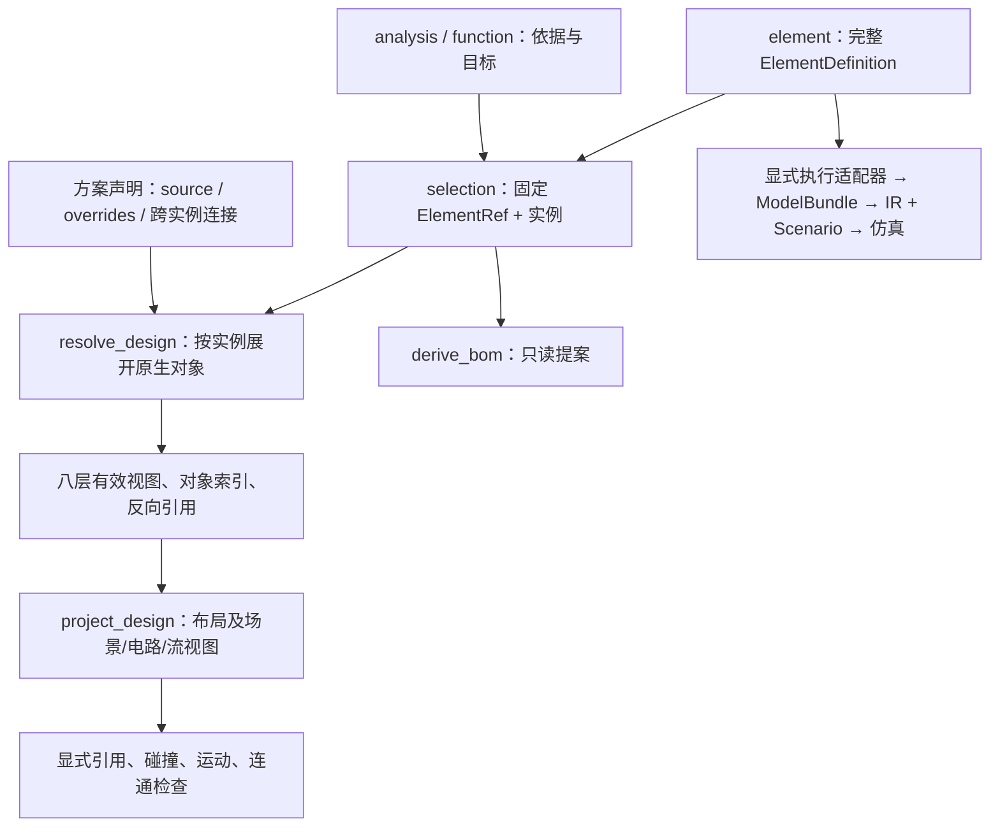

# 多层级设计协议：元件定义、方案实例与八层设计

更新日期：2026-10-23。代码基线：`6b98b3c`；引擎版本 `0.5.0`；方案协议 `2.0.0-draft`；元件定义协议仍为 `1.0.0-draft`。

本文依据当前 `element/`、`engine/` 实现说明数据归属、八层输入、引用解析和执行边界。字段以[方案契约](../../engine/design/contracts.py)和[元件库契约](../../element/schema/library.py)为准，展开规则以[实例解析](../../engine/design/occurrence.py)为准。相关概览见[元件库](../../element/README.md)、[设计模块](../../engine/design/README.md)和[引擎](../../engine/README.md)。

## 1. 核心架构：元件持有内部定义，方案持有实例与关系

| 对象 | 所属模块 | 权威内容 |
| --- | --- | --- |
| `ElementDefinition` | `element/` | 可复用工程单元的完整定义与固定版本 |
| `DesignPackage` | `engine/design/` | 需求、功能、选型、实例、放置、初始条件和方案连接 |
| `ResolvedDesign` | `engine/design/resolve.py` | 基于固定元件和方案声明计算出的有效只读视图 |
| 布局、IR、仿真输入和结果 | `engine/` | 面向特定执行器的派生表示和执行证据 |
| Context、正式 BOM、批准决定 | 宿主应用 | 项目权威状态、发布和权限控制 |

**选中元件后，不把它的形状、引脚额定值、内部关节和行为程序再复制为一套方案定义。** 同一固定定义可以被多个实例复用；方案描述实例在哪里、以什么初值工作、彼此如何连接。修改内部工程属性，应发布修订或派生元件并重新固定引用。



箭头表示数据依赖，不代表自然语言会自动生成工程对象。方案到 `layout` 的投影与完整 `ModelBundle + Scenario` 仿真是不同入口，当前没有通用的八层方案到物理仿真的编译器。

### 1.1 模块职责

| 路径 | 职责 |
| --- | --- |
| `element/base/` | 严格不可变契约、ID、单位、坐标、信号和证据基础类型 |
| `element/interfaces/` | 局部几何、安装、运动、端子、物料、行为等共享契约 |
| `element/categories/` | 14 类元件的类型化创作模型，不包含引擎执行方法 |
| `element/schema/library.py` | 完整定义、固定引用、能力、参数、目录和查询 |
| `element/io/`、`element/library/` | 受限读写、资产检查、不可变发布和可重建搜索索引 |
| `engine/design/` | 八层方案、实例展开、溯源、检查、BOM 提案、存储和文档交换 |
| `engine/adapters/`、`engine/schema/` | 显式执行转换、装配和规范化执行输入 |
| `engine/compiler/`、`engine/simulator/`、`engine/projection/` | 编译、仿真和执行模型视图 |

`element/` 不依赖 `engine/`、Context、Pi 或模型服务。`ComponentDefinition/PhysicalSpec/ElectronicSpec` 位于 `engine.schema.component`，属于执行表示；旧 `element.schema.model` 路径已移除。类别类型直接从 `element.categories` 导入，执行转换显式使用 `engine.adapters.elements`。

## 2. 八层是什么，分别保存什么

设计由 **8 类记录**组成，每类可有零条、一条或多条，不是固定八步流水线。即使没有显式工程记录，已选元件的内部对象也会在解析视图中出现。

| 层 / `kind` | 要回答的问题 | 方案编辑内容 | 从元件继承的内容 |
| --- | --- | --- | --- |
| 分析 `analysis` | 为什么做？ | Markdown、假设、问题、结论与证据 | 无自动推导 |
| 功能 `function` | 做什么，如何验收？ | 功能分解、类型化端口、标准、实现引用 | 无自动接线 |
| 选型 `selection` | 采用谁，用多少？ | 固定候选、决定、实例或散装数量、实例位姿 | 完整选定定义 |
| 结构 `structure` | 放在哪里，怎样安装？ | 根刚体放置差异、跨单元安装连接 | 刚体、包络、安装口 |
| 运动 `motion` | 如何运动、初始状态是什么？ | 初值差异、跨单元关节、驱动命令或来源 | 内部关节、传动 |
| 电路与能量 `circuit_energy` | 电与能量怎样连接？ | 网络、跨单元能量传递 | 端子、额定值、非电能量端口 |
| 物料与信息流 `flow` | 从哪里到哪里？ | 外部有向边、必需路径 | 物料/信息端口、内部物料路径 |
| 逻辑 `logic` | 怎样组合信号和控制？ | 方案单元、边界端口、绑定、方案执行顺序 | 接口、行为及其类型化端口 |

“层”按领域分类，“元件/方案”按所有权划分。例如同一电路层中，端子属性属于元件，连接端子的 `nets` 属于方案。

## 3. 元件库：完整工程单元与固定引用

### 3.1 `ElementDefinition`

外壳包含必填 `library_id/element_id/name/category/model`、默认 `revision=1`，另有 `subtype/form/origin/roles/tags/product/description_markdown/parameters/capabilities/information_ports/energy_ports/sources/evidence` 等字段。外壳身份、修订和类别必须与 `model` 一致。

`model` 保存完整的 14 类创作模型：`structure/transmission/actuator/light/display/sound/human_input/sensor/controller/driver/power/transport/energy_storage/circuit_element`。软件形态、来源和能力是独立属性，不额外增加类别。

元件拥有内部几何、安装口、端子及额定值、关节/传动、物料路径、接口、行为绑定、传感器和类别专有描述。库级 `information_ports/energy_ports` 也属于同一个固定定义。`collections()` 直接提供原生对象，不先降低为执行模型。

端子属性与电气验证、物料端口属性、声明式 `BehaviorProgram` 在 `element.interfaces` 单一定义，方案视图复用这些契约。电源有效端子由 `PowerSource.electrical` 提供，保持库实例与仿真输入一致。

### 3.2 固定与检索

`ElementRef={library_id,element_id,revision,content_hash}`，由 `element.io.records.element_ref(definition)` 计算，不手写哈希。元件哈希使用 `element-v1` 域；确定性编码不等同于 RFC 8785。

`ElementLibrary(root).publish(definition)` 发布不可变版本，同身份同修订不能发布不同内容；`get(ref)` 获取确切版本；`search(ElementQuery(...))` 返回候选。搜索支持文本、类别、能力、协议和量纲检查后的数值过滤；默认不以未经验证的假设数值满足数值条件。搜索命中不代表满足方案需求。

定义文件是权威源，SQLite 索引可以重建。库目录必须显式提供，运行数据放在被忽略的 `workspace/` 下。搜索、元件发布和 BOM 推导均不赋予应用批准权限。

## 4. 共用记录、包与身份

### 4.1 `DesignRecord`

| 字段 | 必填或默认 | 含义 |
| --- | --- | --- |
| `record_kind` | 默认 `design_record` | 记录种类 |
| `schema_version` | 默认且只接受 `2.0.0-draft` | 方案协议版本 |
| `design_id/record_id/title` | 必填 | 所属设计、稳定记录 ID、标题 |
| `kind/data` | 必填 | 八类判别值及对应内容 |
| `revision` | 默认 `1` | 正整数修订 |
| `maturity` | 默认 `draft` | `draft/specified/archived`，不等于检查结论 |
| `tags/links` | 默认 `[]` | 标签和溯源链接 |
| `sources/evidence` | 默认 `{}` | 本记录来源和证据 |

`links[].relation` 为 `motivates/decomposes/realizes/constrains/depends_on/documents`，目标为方案 `ObjectRef`。证据条目包含 `basis/statement`，可带 `source_ids/artifact_refs`；`basis=datasheet/measurement/assumption/derived`。来源条目包含 `title/locator`，可带 `source_revision/retrieved_at`。证据和来源 ID 在所属记录内解析，不能跨记录借用同名键。

契约严格校验、冻结对象、拒绝额外字段和非有限值；不能把数字字符串、任意业务字段或未声明脚本塞入契约。ID 与显示标题分离，改标题不改变身份。

### 4.2 `DesignManifest` 与 `DesignPackage`

清单包含 `design_id/revision/title/layers/input_revisions`。`layers` 必须有全部八个 `kind` 键，值为 `RecordRef` 数组，空层保留空数组。`RecordRef={record_id,revision,content_hash}`，每条记录只能固定一次。

包由 `manifest/records/elements` 组成；包与清单的 `record_kind` 分别为 `design_package/design_manifest`，版本均为 `2.0.0-draft`。`records` 仅保存创作记录；`elements` 可内嵌完整元件定义，也可省略并在 Python API 中显式传入 `ElementLibrary`。

`make_package()` 生成清单与哈希；`resolve_design()` 进一步核对设计 ID、类别、修订、内容哈希及全部固定记录。缺失、未固定或重复记录、元件哈希冲突会拒绝解析；不完整设计关系通常保留为诊断。

记录哈希使用 `design-record-v2` 域，方案快照由清单使用 `design-manifest-v2` 域计算。`input_revisions` 保留宿主输入版本，不代替当前 Context 校验，也不等同于旧布局或 bundle 快照。

## 5. 三种引用与实例展开

| 引用 | 形状 | 范围 |
| --- | --- | --- |
| `ElementRef` | `library_id/element_id/revision/content_hash` | 固定元件版本 |
| `ElementBinding` | `instance_ref + local_ref` | 某实例的局部元件对象 |
| 方案 `ObjectRef` | `record_id`，可带 `collection/object_id` | 创作记录或当前有效视图中的对象 |

例如 `{"record_id":"selection","collection":"instances","object_id":"left"}` 指向选型实例；`{"record_id":"goal"}` 指向整条记录。`collection/object_id` 必须同时出现或同时省略。引用在当前固定方案及其派生实例视图内解析。

`ElementBinding.local_ref` 使用元件命名空间，如 `{collection:"envelopes",object_id:"case"}`，对应方案集合为 `geometry`，不能直接互换。

### 5.1 局部对象到方案集合的映射

| 元件集合 | 有效视图所在层 / 集合 |
| --- | --- |
| `bodies/envelopes/mounts` | `structure` → `bodies/geometry/mounts` |
| `joints/transmissions` | `motion` → `joints/transmissions` |
| `terminals/energy_ports` | `circuit_energy` → `terminals/energy_ports` |
| `material_ports/information_ports` | `flow` → `ports` |
| `material_paths` | `flow` → `edges` |
| `interfaces/behaviors` | `logic` → `interfaces/units` |

`visual_assets/sensors` 在原生集合和 `element_occurrences` 中保留，但没有上述工程层地址映射，不能对任意原生集合调用 `occurrence_ref()`。

方案还可引用 `analysis.conclusions`、`function.inputs/outputs/criteria`、`selection.requirements/candidates/instances` 及各工程层自有集合。逻辑端口通过 `unit_inputs/unit_outputs`，对象 ID 为 `单元ID:端口ID`。散装用量若声明实例，通过 `instances/bulk` 访问。

### 5.2 解析过程与读取 API

1. 校验清单和元件引用，解析选定定义，关联到每个实例。
2. 读取原生集合，为每个实例生成独立、确定的方案对象地址。
3. 应用显式来源声明和允许差异，把内部引用重绑定到本实例的方案地址。
4. 合成有效记录，建立对象索引、反向引用和语义诊断。

`resolved.occurrence_ref(instance_ref,"bodies","case")` 返回当前有效地址，识别显式别名。模块级同名函数只计算默认地址，不查询别名；有方案声明时优先用解析实例上的方法。生成地址含确定性哈希，不应手拼或占用自动生成的记录命名空间。

`resolved.get(ref)` 读取方案对象；`resolved.element_object(binding)` 获取实例上下文中的完整原生对象；`resolved.instance_elements` 获取选定定义。保留 `binding.instance_ref` 才能解释原生对象的局部引用。

**持久化 `resolved.package`，不要把 `resolved.records` 写回清单。** 后者包含自动生成的有效记录，不是新的权威创作源。

## 6. `source + overrides`：继承与差异规则

下面是可供 `parse_record()` 解析的完整结构记录；其引用还需在包含对应选型和元件的包内解析：

```json
{
  "schema_version": "2.0.0-draft",
  "design_id": "servo_demo",
  "record_id": "placement",
  "kind": "structure",
  "title": "左舵机根刚体放置",
  "data": {
    "bodies": {
      "left_case": {
        "source": {
          "instance_ref": {"record_id": "selection", "collection": "instances", "object_id": "left"},
          "local_ref": {"collection": "bodies", "object_id": "case"}
        },
        "overrides": {
          "pose": {"translation_m": [0.1, 0.0, 0.0]},
          "placement": "specified"
        }
      }
    }
  }
}
```

这将 `case` 暴露为 `placement/bodies/left_case`，内部几何和关节引用随之重绑定，不额外增加刚体。

| 内容 | 当前规则 |
| --- | --- |
| 只有 `source`，可带空 `overrides` | 继承元件对象，赋予显式方案地址 |
| 无内部关节父节点的刚体 | 可覆盖 `pose/placement`，通常用于根刚体 |
| 非固定关节 | 可覆盖 `initial`，不能改变轴、限位和内部拓扑 |
| 其他内部属性 | 不允许覆盖，应修改或派生元件并更新引用 |
| 完整属性并带 `source` | 必须与继承结果一致，否则报告冲突 |
| 为已选实例增加无来源的内部对象 | 受所有权检查的对象报告 `element.source_required` |
| 同一局部对象声明多个地址 | 报 `element.duplicate_source` |

差异按嵌套字典合并，再对完整值校验。例如 `initial:{value:0.5}` 保留原单位；为便于审阅，建议显式填写单位。不允许属性或越界初值报告 `element.override_intrinsic/element.override_invalid`；来源错配、缺失分别报告 `element.source_type/element.local_ref`。

## 7. 八层输入字段与语义

下列字段都位于记录 `data`，集合默认空。工程层内部对象优先用继承表达；完整属性类型主要用于有效视图。

### 7.1 分析 `AnalysisData`

`purpose` 默认为 `other`，可选 `background/requirements/feasibility/tradeoff/risk/decision/other`。`body={format:"markdown",text,attachments}`；`subjects` 是讨论对象引用；`conclusions` 是结论字典。

结论必填 `statement/basis`，可带 `evidence_ids/affects`。结论 `basis=assumption/evidence/open_question`，区别于证据条目的分类。正文保留论证，结构化结论供追踪；不自动提取可执行约束。

### 7.2 功能 `FunctionData`

字段为 `body/parent/inputs/outputs/criteria/realizations`。`parent` 指向父功能记录；输入输出条目为 `{name,type,required}`，`required` 默认 `false`。

标准条目为 `{statement,metric,target,method,evidence_ids}`，`statement/method` 必填；`method=inspection/calculation/simulation/physical_test`，`target` 可带数量上下界。`realizations` 指向实现对象。声明仿真验收不触发仿真，也不将功能端口自动接到引脚。

### 7.3 选型 `SelectionData`

| 字段 | 输入 |
| --- | --- |
| `function_refs` | 所服务的功能记录 |
| `requirements` | `statement/parameter_code/min/max/required`；`required` 默认 `true` |
| `candidates` | `element_ref/reason/assessments`；评估键须对应需求 |
| `chosen_candidate_id` | 候选字典键，默认 `null` |
| `decision` | Markdown 决策说明 |
| `usage` | 离散实例或散装数量 |

评估结果为 `match/mismatch/unknown`，可附本记录证据。当前不自动按需求区间完成选型。

离散用量形如 `{kind:"discrete",planned_count:2,instances:{left:{label:"左",pose:{}},right:{label:"右"}}}`。`Instance` 仅有 `label/pose/parent_instance`；无 `pose` 时位置未知，`{}` 表示原点单位位姿。实例父关系用于层级追踪和循环检查，不能当成安装连接或固定关节。

散装用量形如 `{kind:"bulk",quantity:{value:2.0,unit:"m"},instance:null}`，数量非负，需要参与工程关系时提供实例。离散计划数须与实例条数一致；BOM 按选型数量汇总，不按刚体数计数。

v2 已移除实例 `parameter_bindings/occurrence_map`。尺寸、行为等变化应先在元件侧物化为完整固定定义，再选择。

`instantiate_element(definition,design_id=...,instance_id=...,pose=...)` 只创建选型记录并内嵌定义，返回 `package/identity_map`，不调用旧布局导入或执行适配器，不返回损失报告。

### 7.4 结构 `StructureData`

集合为 `bodies/geometry/mounts/connections`，前三者支持 `InheritedObject`。安装连接为 `{a,b,kind,joint_ref}`，`a/b` 指向安装口，`kind=fixed/joint`，仅后者要求关节引用。

有效刚体提供 `instance_ref/source/parent_body/pose/placement`。`unplaced` 要求 `pose=null`；`specified/suggested` 都须有位姿并参与投影。`parent_body` 用于组合相对坐标，不产生固定关节。

有效几何有 `body_ref/shape/pose/purpose/approximation/margin_m`；安装口有 `body_ref/pose/interface_kind`。形状契约支持 `box/sphere/cylinder/capsule/convex_asset/triangle_mesh`，但后端支持范围不同。视觉资产和完整元件元数据不能从窄布局视图恢复。

### 7.5 运动 `MotionData`

集合为 `joints/transmissions/drives`。内部关节/传动从元件继承；跨单元关节显式填写 `parent_body/child_body/kind`、锚点及适用的轴、限位和初值。

关节 `kind=fixed/revolute/continuous/prismatic`，移动关节需要单位轴和初值，转动量用角度量纲，平移量用长度量纲。传动为 `driver/follower/kind/factor/offset`，支持 `rotary_ratio/screw`。

驱动为 `joint_ref/mode/command/speed_limit/input_ref`，`mode=position/velocity`；`command/input_ref` 不能同时提供，速度上限须为正且量纲匹配。驱动声明不自动进入布局执行器的时序控制；`joint_inputs` 是显式检查输入。

### 7.6 电路与能量 `CircuitEnergyData`

集合为 `terminals/nets/energy_ports/transfers`。端子、额定值、非电能量端口从元件继承，方案主要编辑网络和传递。

`Net={kind,members,reference_net}`，`kind=signal/power/ground`；至少两个不同端子，单个端子不能属于多个命名网络。有效端子包含 `instance_ref/spec/body_ref/pose/source`，`spec` 复用元件端子属性并绑定方案引用。

`EnergyTransfer={carrier,from,to,via,ratings}`。`electrical` 端点是端子，`via` 指向网络；`rotational/linear/thermal` 端点是匹配载体的能量端口。非电端口本身不接受 `carrier="electrical"`。记录关系与额定值不表示已做电流、热或机械能量求解。

### 7.7 物料与信息流 `FlowData`

集合为 `ports/edges/required_paths`。端口和内部物料路径从元件继承；方案描述外部连接和必需可达路径。

端口公共字段为 `instance_ref/direction/required/body_ref/pose/source`，`direction=in/out/bidirectional`。物料端口带 `domain="material"/medium/spec`；信息端口带 `domain="information"/type/interface_ref`。

边为 `{domain,from,to,scope,mechanism,constraints,physical_binding_refs}`，`to` 为非空引用数组，默认 `scope="external"`。外部边从输出到输入，内部物料路径从同实例入口到出口。解析器检查域、方向和介质/类型一致；必需路径可达性由连通检查处理。

库级信息端口 `data_type` 字符串当前映射为 `StreamType(schema_id=data_type)`，不能仅凭名称当作布尔或标量。拓扑通过不代表流量、压降或协议执行通过。

### 7.8 逻辑 `LogicData`

集合为 `interfaces/inputs/outputs/units/bindings`，另有 `execution_order`。边界端口为 `{name,type}`；单元端口字典值直接为 `ValueType`。绑定为 `{source,target}`，单元端口 ID 为 `单元ID:端口ID`。

| 单元 `kind` | 主要字段 | 当前含义 |
| --- | --- | --- |
| `element` | `source`，解析提供名称、实例及类型化端口 | 引用完整元件行为，程序和内部顺序仍属于元件 |
| `declarative` | `name/behavior`，可带端口与供电引用 | 方案声明式组合单元 |
| `code` | `name/source`，`language="python"`，可带 `environment_ref` | 保存源码，不执行 |
| `markdown` | `name/body` | 文档单元，不能声明端口 |
| `firmware_reference` | `name/target/assets` | 固件引用，不编译或烧录 |

`behavior` 复用 `element.interfaces.behavior.BehaviorProgram`，包含 `model_id/output_type` 和可选参数、状态、迁移。内置模型受注册契约约束，不是动态 Python 入口。

**`execution_order` 只列方案自有单元，每个恰好一次；不列 `ElementUnit`。** 元件行为不应复制为方案程序重新编排。

解析器检查引用、可用端口类型、显式类型相等及同一逻辑记录中的重复绑定目标；没有全面证明所有端口方向、跨记录多写者或控制网络可执行性。转换需显式建单元；保存执行顺序不代表控制循环已运行。

## 8. 数量、类型、位姿与资产

`Quantity={value,unit}`，例如 `{value:0.5,unit:"rad"}`；上下界为 `{min:Quantity,max:Quantity}`，任一端可省。`_m` 几何字段直接填米制数值。量纲区分角度、长度、角速度、速度等。

方案 `ValueType` 有 `boolean`、带 `unit` 的 `scalar`、带 `values` 的 `enum`、带 `schema_id` 的 `event/stream`。元件 `SignalType` 是另一套契约，解析器显式映射，例如 `digital` 转为 `enum:["0","1","X","Z"]`，不能混写。

`Pose` 为 `translation_m:[x,y,z]`、归一化 `rotation_xyzw:[x,y,z,w]`，`{}` 为单位位姿。内部子刚体初始位姿由关节锚点和初值计算；未知位姿不会自动置于原点参与碰撞。

`AssetRef` 必须带 `sha256/media_type`，并在 `artifact_id/relative_path` 二选一。引用存在不代表内容已验证；资产读取依赖显式受限解析器，CLI 资产由宿主验证后内联提供，不接受任意库路径。

## 9. 可运行示例：双舵机实例与八类创作记录

在仓库根目录、具备 Pydantic 2 的 Python 环境运行下列代码。它显式加载仓库合成模板，为同一定义建立两个实例，结构层改放置、运动层改初值、逻辑层连接方案单元和驱动。模板没有的电路和流保持空记录，不臆造能力。

```python
import json
from pathlib import Path
from element.io.components import load_component
from element.io.records import element_ref
from element.schema.library import ElementDefinition
from engine.design import make_package, resolve_design, project_design, check_design, compile_design
from engine.design.contracts import ObjectRef
from engine.design.bom import derive_bom

model = load_component(Path("engine/examples/components/servo.json"))
definition = ElementDefinition(
    library_id="demo", element_id=model.id, revision=model.revision,
    name=model.name, category=model.category, origin="template", model=model,
)
pin = element_ref(definition)
instance = {"record_id": "selection", "collection": "instances", "object_id": "left"}

def ref(record_id, collection, object_id):
    return {"record_id": record_id, "collection": collection, "object_id": object_id}

def inherited(collection, object_id, overrides):
    return {"source": {"instance_ref": instance,
                       "local_ref": {"collection": collection, "object_id": object_id}},
            "overrides": overrides}

def record(kind, record_id, data):
    return {"design_id": "servo_demo", "record_id": record_id,
            "kind": kind, "title": record_id, "data": data}

scalar = {"kind": "scalar", "unit": "rad"}
records = [
    record("analysis", "analysis", {
        "purpose": "requirements",
        "body": {"text": "# 双舵机概念\n尺寸和性能均为合成假设。"},
        "conclusions": {"concept": {"statement": "验证实例继承与连接表达。",
                                      "basis": "assumption"}},
    }),
    record("function", "goal", {
        "body": {"text": "# 角度控制\n将设定角度传给左舵机驱动。"},
        "inputs": {"angle": {"name": "角度", "type": scalar}},
        "criteria": {"inspection": {"statement": "引用和类型一致。", "method": "inspection"}},
        "realizations": [{"record_id": "selection"}],
    }),
    record("selection", "selection", {
        "function_refs": [{"record_id": "goal"}],
        "candidates": {"servo": {"element_ref": pin.model_dump(mode="json")}},
        "chosen_candidate_id": "servo",
        "usage": {"kind": "discrete", "planned_count": 2, "instances": {
            "left": {"label": "左舵机", "pose": {}},
            "right": {"label": "右舵机", "pose": {"translation_m": [0.3, 0.0, 0.0]}},
        }},
    }),
    record("structure", "placement", {"bodies": {
        "left_case": inherited("bodies", "case", {
            "pose": {"translation_m": [0.1, 0.0, 0.0]}, "placement": "specified",
        }),
    }}),
    record("motion", "motion", {
        "joints": {"left_axis": inherited("joints", "axis", {
            "initial": {"value": 0.5, "unit": "rad"},
        })},
        "drives": {"position": {
            "joint_ref": ref("motion", "joints", "left_axis"), "mode": "position",
            "speed_limit": {"value": 1.0, "unit": "rad/s"},
            "input_ref": ref("logic", "unit_outputs", "relay:value"),
        }},
    }),
    record("circuit_energy", "circuit", {}),
    record("flow", "flow", {}),
    record("logic", "logic", {
        "inputs": {"request": {"name": "角度设定", "type": scalar}},
        "units": {"relay": {"kind": "declarative", "name": "角度传递",
            "inputs": {"value": scalar}, "outputs": {"value": scalar},
            "behavior": {"model_id": "pass", "output_type": scalar}}},
        "bindings": {
            "request_to_relay": {"source": ref("logic", "inputs", "request"),
                                 "target": ref("logic", "unit_inputs", "relay:value")},
            "relay_to_drive": {"source": ref("logic", "unit_outputs", "relay:value"),
                               "target": ref("motion", "drives", "position")},
        },
        "execution_order": ["relay"],
    }),
]
package = make_package(
    design_id="servo_demo", title="双舵机概念", records=records, elements=(definition,),
)
resolved = resolve_design(package)
assert not resolved.diagnostics, resolved.diagnostics
body_ref = resolved.occurrence_ref(ObjectRef(**instance), "bodies", "case")
assert body_ref.key() == "placement/bodies/left_case"
assert resolved.get(body_ref).pose.translation_m[0] == 0.1
assert resolved.get(ObjectRef(**ref("motion", "joints", "left_axis"))).initial.value == 0.5
assert resolved.package.elements[0] == definition
views = project_design(package)
report = check_design(package, "references")
compiled = compile_design(package, target="layout")
bom = derive_bom(package)
assert report["outcome"] == "pass"
assert views["snapshot_id"] == compiled["snapshot_id"] == bom["snapshot_id"]
assert len(bom["items"]) == 1 and bom["items"][0]["quantity"]["value"] == 2
assert len(views["resolved_records"]) > len(views["records"])
print(json.dumps({"records": len(package.records), "elements": len(package.elements),
                  "bom_quantity": bom["items"][0]["quantity"]["value"],
                  "references": report["outcome"]}))
```

预期输出 `{"records":8,"elements":1,"bom_quantity":2,"references":"pass"}`（空白可能不同）。八条创作记录内嵌一份元件定义，内部工程对象由解析生成。布局编译仅证明形成执行输入，此例没有运行控制循环、固件或物理仿真。

## 10. 投影、检查、编译与 BOM

### 10.1 `project_design()`

输出场景、电路、流和布局数据，并提供：

| 字段 | 含义 |
| --- | --- |
| `records` | 持久化创作记录 |
| `resolved_records` | 合并元件实例和方案差异的有效记录 |
| `element_occurrences` | 按实例保留的完整原生对象元数据 |
| `reference_index` | 目标到引用者的反向索引 |
| `design_diagnostics` | 来源、引用和设计语义诊断 |
| `projection_omissions` | 显式省略项，如未放置刚体、不完整网络 |
| `snapshot_id/layout_snapshot_id` | 方案快照和底层布局指纹；各视图绑定方案快照 |

布局只消费可映射子图，不能作为权威元件表示。`projection_omissions` 不穷举未执行语义，即使为空，驱动、逻辑、能量仍不一定进入执行器。

### 10.2 检查与编译

`check_design()` 支持 `references/collision/motion/connectivity`，其他检查返回 `unsupported`。报告含 `snapshot_id/tool_version/options_hash/status/outcome/coverage/diagnostics`。`status="completed"` 仅表示调用完成，应同时读取 `outcome=pass/fail/unknown`、覆盖和诊断。

| 输入 | 当前能力 | 结论范围 |
| --- | --- | --- |
| 分析、功能、证据 | 保存、固定、溯源 | 不自动完成分析或验收 |
| 选型、实例 | 定义解析、计数、BOM 汇总 | 不自动采购或批准 |
| 结构、关节、传动 | 布局、显式碰撞和运动检查 | 不代表 CAD、受力、配合或制造验证 |
| 端子、网络、流路径 | 部分语义和连通检查 | 不代表电路数值求解、CFD 或协议执行 |
| 能量、逻辑、驱动 | 契约、引用、部分类型检查 | 不等于时序控制或能量求解 |
| Python、Markdown、固件 | 内容与资产记录 | 不执行代码、不编译或烧录固件 |

`compile_design(target="layout")` 在无错误级诊断且无布局省略时生成固定布局输入，其他目标拒绝。完整仿真仍显式使用执行适配器、`compile_model()` 和 `ModelBundle + Scenario`。理想模型仿真通过也不等于实物通过。

`derive_bom()` 按固定引用和单位聚合选型数量，保留 `source_refs/input_revisions/snapshot_id`，散装量按 SI 归一。来源冲突、未选定、定义不可用、实例计数不符会阻止派生。它返回只读提案，不校验所有工程域，也不发布正式 BOM。

## 11. CLI、存储与应用接入

### 11.1 有界 JSON 请求

`python -m engine request` 从标准输入读取一个请求，报文为 `{request_id,method,design,...}`。宿主传入完整内联包，CLI 不接受任意库目录参数。

| `method` | `design` 输入 | 其他字段或结果 |
| --- | --- | --- |
| `design_validate` | `DesignPackage` | 方案诊断 |
| `design_project` | `DesignPackage` | 有效视图 |
| `design_check` | `DesignPackage` | `check_kind`，可带 `joint_inputs/assets` |
| `design_compile` | `DesignPackage` | `target="layout"` |
| `design_bom` | `DesignPackage` | 只读 BOM 提案 |
| `design_instantiate` | `ElementDefinition` | 当前分派器使用默认参数，定制实例参数使用 Python API |

分别运行 `python -m engine schema design_record`、`design_manifest`、`design_package` 可导出 JSON Schema，每次只传一个名称。Schema 检查字段形状，跨对象语义仍需解析器。

`design_import/migrate_layout` 路径已移除。布局投影不能恢复完整元件，应先导入或创作权威元件，再选择版本、建立实例和方案连接。

### 11.2 存储与 Markdown

`DesignStore(path)` 是应用可选 SQLite 仓库，不自动替换现有 Context。`commit(package,expected_manifest_revision=N)` 要求新清单修订为 `N+1`，原子 CAS 检查当前头，拒绝同记录修订的内容变更，支持历史读取。草稿关系可带诊断保存，固定引用和哈希仍须合法。

`engine.design.documents.export_documents()/import_documents()` 提供文件交换。分析、功能正文各存为 `.md`，`design-export.json` 不重复正文；导入变更会递增记录和清单修订。路径限定在导出根目录，资产保留哈希。导出创作包，不回灌有效记录副本。

### 11.3 应用边界

八层协议是 Python/JSON 能力，不代表已经有八层网页编辑器或新的认证项目路由；现有工作台继续使用布局 API。执行隔离、资产验证、当前 Context 核对、正式 BOM 发布由宿主承担。批准决定仅在认证应用路由，不放入 agent 工具。

## 12. 旧版迁移与验证

| 旧版说法或用法 | 当前做法 |
| --- | --- |
| 方案 `1.0.0-draft` | 使用 `2.0.0-draft`；不能只替换版本标签 |
| `source` 只是备注，不继承 | 来源驱动展开，使用 `source + overrides` |
| 抄写内部几何、端子、关节 | 元件唯一持有，方案保存实例和关系 |
| `parameter_bindings/occurrence_map` | 字段移除，内部变化先物化为固定元件 |
| 实例化经过布局转换并返回损失 | 直接写选型，返回 `package/identity_map` |
| 执行顺序包含所有元件行为 | 仅列方案自有单元 |
| `design-record-v1/design-manifest-v1` | v2 域重新生成引用和清单 |
| 从布局导回权威定义 | 先建立元件，不能反向恢复丢失信息 |

建议编辑顺序：分析与功能 → 固定元件 → 实例 → 放置/初值差异和跨实例关系 → 解析诊断 → 显式检查及覆盖审阅 → 执行输入与 BOM 提案。修改内容后递增记录修订，用 `make_package()` 重建清单，不保留旧哈希。

本次仅更新文档，不修改应用或 CAD worker。验证结果记录在下方；旧版示例和历史测试计数不作为当前执行证据。

2026-10-23 实际验证：本文 JSON 记录通过 `parse_record()`，Python 示例实际输出 `{"records": 8, "elements": 1, "bom_quantity": 2, "references": "pass"}`。显式别名、放置与初值继承、定义不变、有效记录展开、布局输入编译及快照一致性断言全部通过；6 个本地 Markdown 链接有效。

使用仓库 `.venv-engine` 运行 `element/tests` 12 项和 `engine/tests` 131 项，共 **143 项测试通过**。首轮默认临时目录受沙箱权限限制，复跑将 Python `tempfile.tempdir` 指向 `workspace/doc-validation-temp`，未修改测试或运行代码。未据此声称固件、真实电路或制造成功。

本文件位于仓库当前忽略的 `/agent/` 目录，更新保存在本地文件；本次未修改忽略规则或强制加入 Git。
