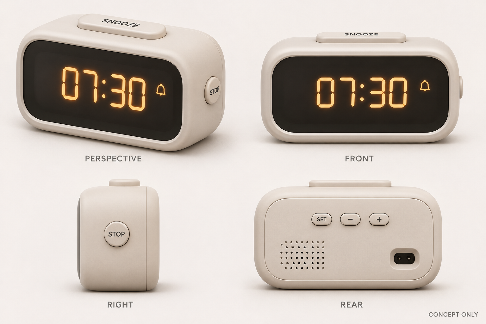

# 02 · 外观设计

版本：`0.1`。进度：方向已确定，概念图已生成；配色、尺寸与按键布置为待确认建议。日期：2026-11-06。生成时上游：[需求 v0.2、功能 v0.1 的历史输入](upstream-v0.1.json)、[SRC-03](../requirements/source.md)。当前需求已更新，见文末选型影响。流程：`doc/tasks/index.json`。

## 形态与视觉

采用横向圆角盒体，正面为大面积内嵌深色圆角显示窗，保留窄边框。顶部突出一枚宽贪睡键，便于摸到；停止键放右侧，与贪睡键在位置和形状上区分。前面不放设置键，以保持读时区域简洁。

本轮建议暖白哑光壳体、深灰显示窗、琥珀色数字。用户仅确认形态，配色与表面意向尚未确认；哑光是视觉目标，不代表已选材料或表面工艺。图中分段数字不限定实际显示器件。

## 交互分区

| 区域 | 本轮方案 | 需求与后续检查 |
| --- | --- | --- |
| 正面 | 大字时分，辅以闹铃标志；贪睡等待标记后续细化 | R-02/07/11；检查观察距离及夜间可读性 |
| 顶部 | 单枚宽胶囊形贪睡键，略高于壳面 | R-05/09；盲操作、按压力、行程和稳定性待实测 |
| 右侧靠前 | 小圆形停止键，区别于顶部大键 | R-04/09；左右床头摆放时的可达性需检查 |
| 背面 | SET、−、＋三个设置键；日常模式下 −/＋暂拟切换亮度 | R-03/06；进入设置模式后才用于改值，具体映射待确认 |
| 背面下部 | 低压电源入口意向、发声开孔及后盖分缝 | 接口类型、孔位、紧固与声学均待选型和 CAD |
| 底面 | 平稳支撑面，后续评估防滑脚垫 | R-09；尚无结构或稳定性验证 |

共五枚实体按键为本轮建议：贪睡、停止、设置、减、加。闹铃启停和设时如何进入设置，需在交互细化时验证操作步数。图中的英文键名仅为示意，未锁定最终丝印语言。

## 概念尺寸

数值为本轮设计建议，用于比较形态，不是用户要求或硬件测量值。以下采用宽 X、高 Z、深 Y 的说法，不在此阶段建立工程世界位姿。

| 项目 | 暂拟尺寸 mm | 目的与边界 |
| --- | --- | --- |
| 主壳外廓，不含按键突出 | 120 宽 × 65 高 × 50 深 | 横向可读与床头占地折中；需确认可用空间 |
| 正面显示窗 | 约 100 宽 × 43 高 | 时间及状态区；有效发光区取决于实际显示器 |
| 顶部贪睡键 | 约 52 宽 × 16 深 | 明显的触觉目标；高度、行程、间隙未定 |

圆角半径、壁厚、内部净空、螺钉、止口与按键导向均未定。图像比例不构成尺寸约束，不能从中反推加工尺寸。

## 夜间表达

默认时分显示与日间一致，通过降低亮度适应床头使用，不增加动画。夜间时段、最暗档、是否熄屏及手动覆盖策略仍待确认。琥珀色及渲染亮度不构成不刺眼、助眠或声光性能的验证结论。本轮没有独立的夜间效果图，也未检验夜间性能。

## 图像登记与视觉检查

实际资产：[concept-board-v0.1.png](concept-board-v0.1.png)。来源：内置 image_gen，原创概念生成，无外部参考图片。完整提示词：[prompt-v0.1.md](prompt-v0.1.md)。文件字节哈希与上游版本记录见 [assets-v0.1.json](assets-v0.1.json)。

| 画面 | 用途 | 已观察到的内容 |
| --- | --- | --- |
| 左上 PERSPECTIVE | 轴测形态与主要操作区域 | 横向圆角壳体、深色窗、顶部大键及右侧停止键清楚 |
| 右上 FRONT | 正面读时与视觉层级 | 07:30 与闹铃图标；没有前置设置键 |
| 左下 RIGHT | 侧面体量与按键区分 | 侧面停止键、顶部贪睡键的突出和后盖分缝 |
| 右下 REAR | 后部功能区 | 三个设置键、发声开孔、接口预留区域 |

四视角为同一张生成图的概念表达，已目视检查；不构成正投影 CAD。侧键的前后位置、圆角、按键高度与壳体深度在视角之间仍有生成图误差，后续 CAD 必须统一。

背面接口被模型画成带接点的凹口，其形状不代表已选连接器，不能按此采购或接线。实际仅保留“外接低压电源入口位于背面”的意向，接口需随电源方案重新设计。当前未验证元件包络、装配、公差、声学与按键运动。

## 下一步

需求已更新至 v0.3，用户确认整机备用、体积优先。图像生成时的原始上游 v0.2/v0.1 已归档为 [历史输入快照](upstream-v0.1.json)，本图继续作为形态参考。

选型发现实际OLED发光区约55.01×27.49mm，不能填满图中大字区域。当前布局暂增深度至60mm，背面接口按Feather USB-C规划；前窗、字高和开孔仍待CAD深化，不从旧图反推尺寸。详见 [空间布局](../spatial_layout/README.md) 和 [电路逻辑布局](../logical_layout/README.md)。已有网络草稿，没有实体CAD、实际装配或接线。
