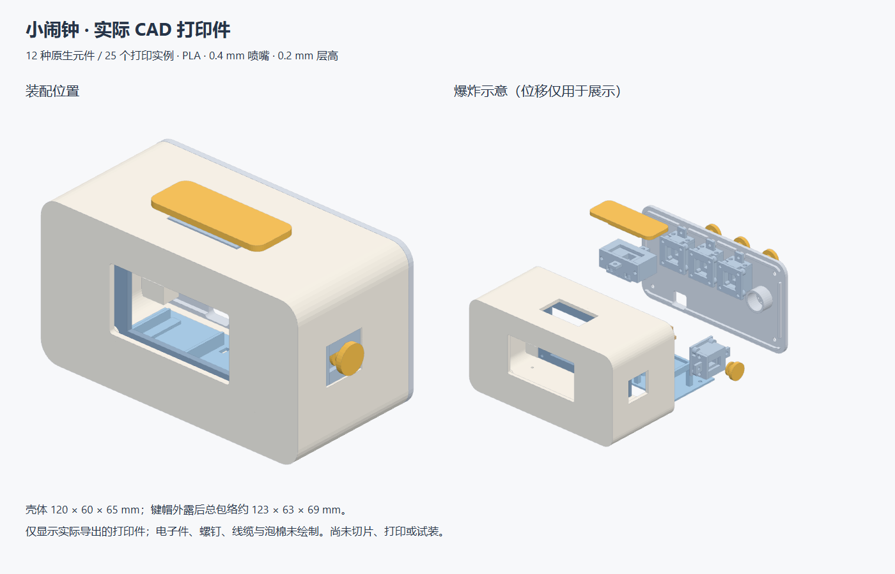

# 06 · 外壳组件深化

版本：v0.1，2026-11-06。流程：`doc/tasks/index.json`。本轮按用户要求创建原生打印元件、实际BRep实体、STEP与STL，并衔接运动、装配及PLA打印优化。当前为可试制的CAD原型，尚未打印或试装。

## 总体与分件

壳体维持120宽×60深×65高mm，前视圆角R8；键帽外露后的总包络约123×63×69mm。墙厚按2.4mm设计。前壳采用后开口，后盖以4枚螺钉拆装，并带每侧0.3mm间隙的定位唇。前窗55.8×28.2mm，围绕所选OLED发光区布置；没有虚构电子模块安装孔。



| 原生元件目录 | 数量 | 主要设计 |
| --- | --- | --- |
| case_front | 1 | 前窗、顶部/侧面按键开口、屏框柱、后盖螺钉座及托架安装孔 |
| case_rear | 1 | 定位唇、后部按键开口、USB开口、声孔及压电定位环 |
| inner_tray | 1 | 控制板边缘支承、扎带孔、电池与RTC分层空间、RTC托座 |
| battery_bridge | 1 | 可拆电池压桥，电池上方名义1.2mm余量，不依赖PLA弹性卡扣 |
| display_clamp | 1 | 可拆屏框，四角固定；与实际屏幕间需柔性垫，不向玻璃施加未验证预紧力 |
| key_guide_large / key_gate_large | 各1 | 顶部宽键导向座与可拆闭合盖 |
| keycap_large | 1 | 52×20mm宽键帽、导向舌、止退肩和实体按压限位 |
| key_guide_small / key_gate_small | 各4 | 右侧停止和后部三个按键共用定义 |
| keycap_small | 4 | 圆键帽、柱形导向、止退肩及限位脚 |
| switch_pcb_retainer | 5 | 从下方可拆的载板保持架，留出THT引线空间，防止将载板封闭在不可装入的腔体中 |

共12种定义、25个打印实例；加原电子方案13个实例，当前项目合计38个实例。每种定义都保存为 `element/<name>/manifest.json + element.json`，资产为 `assets/part.step`、`part.stl`、`print.step`。重复小件共用定义，不复制运行时或元件内部实现。

## 几何与接口

STEP/STL均为mm；原生TriangleMesh明确 `unit: mm`，项目位姿仍用m/xyzw。壳体、托架等共享项目基准作为局部原点；键帽、导向座等采用开关中心局部坐标，局部+Z为向外方向。打印姿态独立于装配位姿。

原生打印元件含真实设计挂点，54条螺钉连接引用这些挂点。电子件固定采用托座、柔性垫和扎带的原型方案，没有推测厂商孔位；开关需要12×12×1.6mm转接载板，其电路焊盘与引脚仍待定义及核对。

CAD细化后的电子布局微调：主控中心Z=8.55mm、RTC中心X=31/Y=24.5mm、压电中心X=42mm、停止开关X=54mm、后三开关Z=46mm。它们解决唇边、屏框、载板保持架和导向座空间冲突，已同步工程位姿及固定关系。

## 来源与执行

- [build_cad.py](../../../../z_bin/cleanup-2026-11-11/examples/project_2/doc/enclosure_detail/build_cad.py)：本项目OpenCascade建模源码，显式执行，不由加载器自动运行。
- [parameters-v0.1.json](parameters-v0.1.json)：设计数值、用户PLA参数与未知项。
- [cad-validation-v0.1.json](cad-validation-v0.1.json)：每件单实体、体积、STEP重读及STL闭合检查。
- [装配检查](../assembly_detail/assembly-v0.1.json) 与 [按压检查](../motion_detail/validation-v0.1.json)：候选快照上的布尔干涉和运动结果。

运行方式（仓库已有OCP工具链）：

```powershell
.\python.cmd examples/project_2/doc/enclosure_detail/build_cad.py
```

模型通过实际OpenCascade执行生成，未使用简单外包络STEP冒充外壳。重读检查不代表真实硬件适配、PLA强度、充电散热或制造成功。OLED厚度、连接器、开关真实行程和载板焊盘仍需实物核对。

独立交付检查见 [verify_cad.py](../../../../z_bin/cleanup-2026-11-11/examples/project_2/doc/assembly_detail/verify_cad.py) 与 [verification-v0.1.json](../assembly_detail/verification-v0.1.json)，会重新打开25个STEP、核对mm单位、原生引用、资产哈希和挂点。重建脚本写当前草稿目录；正式改几何时应先保存新候选，提升原生revision并同步选型/BOM，不直接覆盖已发布版本。
