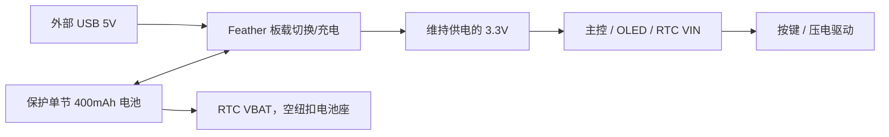

# 05 · 电路逻辑布局

版本：`0.1`，2026-11-06。状态：引脚和网络草稿，原生拓扑检查已执行；EDA、固件及电气实测未完成。上游：需求 v0.3、功能 v0.2、选型 v0.2。空间布局仅用于规划线束。流程：`doc/tasks/index.json`。

工程数据以 `design/circuit-logic.json` 为准，共 **19 个网络**，成员均引用既有原生端子。[端子覆盖表](terminal-coverage-v0.1.json) 登记全部未接原因。

CAD阶段新增打印件没有增加电子端子，网络与GPIO方案保持不变。当前38实例候选的拓扑及电源范围复核见 [validation-v0.2.json](validation-v0.2.json)；原v0.1只绑定旧布局。

## 电源域

| 网络 | 成员 / 意图 |
| --- | --- |
| usb_5v | usb_input/positive、controller/vbus；适配器/线缆采购待定 |
| battery_raw | battery/positive、controller/bat、rtc/bat；保护后约 3.0—4.2V 电池轨 |
| logic_3v3 | controller/v3、display/vcc、rtc/vin；显示及 RTC 主供电保持备用 |
| ground | 电源、主控、电池、显示、RTC、压电返回端和五个按钮 pin4 共地 |

本轮 RTC VBAT 从未用接地的方案改为接主保护电池，电池范围在其 2.3—5.5V 输入范围内。这样在 3.3V 稳压轨关闭时仍可保时，但主电池保护切断后仍需校验时间有效性。纽扣电池座保持空，不得再装一枚电池与主电池并联。[DS3231 手册](https://www.analog.com/media/en/technical-documentation/data-sheets/ds3231.pdf)、[RTC 板引脚说明](https://learn.adafruit.com/adafruit-ds3231-precision-rtc-breakout/pinouts)

USB VBUS、主电池和 3.3V 没有直接并联。切换与充电通路保持在 Feather 内部，网络不模拟其瞬态、充电终止或保护截止。

## GPIO 分配

| 用途 | GPIO | Feather 别名 | 对端 / 模式 |
| --- | --- | --- | --- |
| OLED 时钟 | GP18 | SCK | display/clk，SPI0 |
| OLED 数据 | GP19 | MO / MOSI | display/din，SPI0 单向，无 MISO |
| OLED 片选 | GP09 | D9 | display/cs，软件低有效片选 |
| OLED 数据/命令 | GP10 | D10 | display/dc，推挽 |
| OLED 复位 | GP11 | D11 | display/rst，低有效 |
| RTC 数据 | GP02 | SDA | rtc/sda，I2C1 开漏 |
| RTC 时钟 | GP03 | SCL | rtc/scl，I2C1 开漏 |
| 贪睡 | GP06 | D4 | button_snooze/pin1，上拉输入 |
| 停止 | GP07 | D5 | button_stop/pin1，上拉输入 |
| 设置 | GP12 | D12 | button_set/pin1，上拉输入 |
| 减 | GP24 | D24 | button_minus/pin1，上拉输入 |
| 加 | GP25 | D25 | button_plus/pin1，上拉输入 |
| 压电 PWM | GP08 | D6 | buzzer_r1/a，PWM4A |

**D4=GP06、D5=GP07、D6=GP08**，不能混用 D 别名和 GP 编号。本方案只启用一个 PWM；GP24 虽也能复用 PWM4A，此处为数字输入。没有占用 GP13 板载 LED 或 GP04 BOOT。[Feather 官方引脚表](https://learn.adafruit.com/adafruit-feather-rp2040-pico/pinouts)

初始建议为 SPI0 模式 0、1MHz，I2C1 100kHz、RTC 地址 0x68（7-bit）；均未执行驱动。OLED 保持模块默认 SPI；收到模块后按丝印核对 VCC/GND/DIN/CLK/CS/DC/RST 和线束顺序，不按其他厂商线色接线。Waveshare Wiki 本轮访问受限，来源沿用选型资料，线序需装配前复核。

RTC 板自带 SDA/SCL 上拉至 VIN，本方案 VIN=3.3V，不添加 5V 上拉。测量空闲电平与上升沿后再确定速度/上拉。MCU GPIO 不接收 5V 信号。

## 按键与发声

每个开关暂取对角 pin1 为信号、pin4 为地，pin2/pin3 留空。实际订货件的引脚视图和内部导通仍待核对：焊接前必须确认 pin1—pin4 松开开路、按下导通，并识别未用重复脚；若不成立，更新网络后重新检查，不能改标签掩盖问题。[PTS645 原厂资料](https://www.ckswitches.com/media/1471/pts645.pdf)

内部上拉使按下为低。拟 1ms 采样、连续稳定约 20ms 后产生去抖事件；这是软件建议，不是已测弹跳时间。上电未初始化输入不当作操作，响铃时停止/贪睡优先。原生开关模型使用预先去抖的夹具输入，不模拟接点。

声路：`GP08 → r1(220Ω) → r2(220Ω) → buzzer/a`，`buzzer/b → GND`。两只电阻间的 piezo_series 为独立网络，没有将串阻短接。先将 GPIO 拉低再启 PWM，静音时停 PWM 并拉低。拟 4kHz、50% 占空比、8mA drive strength；drive strength 不是限流保护。实际幅度及壳内音量待测，不足时增版增加驱动。

## 全端子覆盖与版本

73 个建模电子端子中，49 个接入网络，24 个明确未接：按钮 pin2/pin3 共 10 个；RTC clk32/sqw/rst 共 3 个；主控闲置 GPIO 共 8 个，以及 en/rst/aref 共 3 个。完整逐端子记录见覆盖表；未接不表示已经拉地。USB 数据、SWD 与重复地焊盘原本不在 Feather 的建模子集中，不宣称覆盖它们。

主控原生 revision 2 记录拟用的方向、开漏及上拉模式；BAT 采用 passive 表达双向电源接点，不是数字信号。RTC revision 2 记录主电池 VBAT 方案。选型与 BOM 同步为 v0.2，v0.1 元件/项目输入保存在选型基线快照。两只电阻保持原库版本。

## 检查与边界

[validation-v0.1.json](validation-v0.1.json) 和 [pin-plan-v0.1.json](pin-plan-v0.1.json) 记录检查输入与配置计划。项目组合及 engine 连通性检查无错误；另检查端子存在、每端子仅归属一个网络或未接列表、GPIO 分配不重复及关键电源轨范围匹配。

这不是 ERC 或模拟电路验证。仍待实测：按键接点、I2C 上升沿、OLED 线序/亮度、压电波形/声压、充电设定/温升、切换跌落与续航。行为沿用 [功能说明](../requirements/functions.md)，本阶段没有生成、编译或刷写固件。
