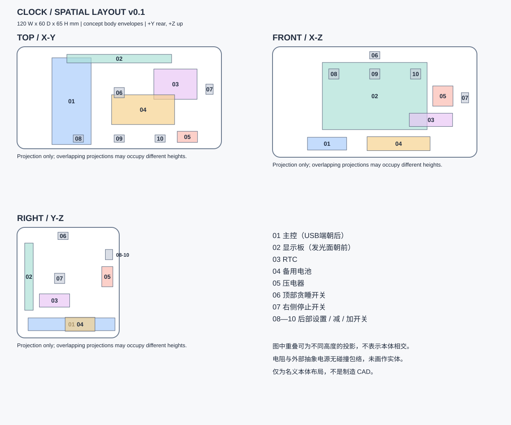

# 04 · 空间布局

版本：`0.2`，2026-11-06。当前工程已随CAD扩展为38个实例。下图保留CAD前的电子布局参考；当前位姿、实体形状和检查以 [CAD阶段](../enclosure_detail/README.md) 与 `design/structure.json` 为准。旧检查绑定原v0.1快照，见装配基线归档。

## 坐标与边界

世界原点在正面底边中点：+X 向右，+Y 向背面，+Z 向上，桌面 Z=0。工程 JSON 用 m 和 xyzw 四元数；下表换算为 mm。元件包络中心是模型原点，不等于厂家安装孔原点。

暂拟外廓改为 **120 宽 × 60 深 × 65 高 mm**。原 50mm 壳深是概念值；Feather 长 51mm，USB 朝后时放不进扣除两侧壁预留的 46mm 深度。本轮增加 10mm 深度，保留圆角横向形态。

按每侧 2mm 的设计预留，以矩形区域 X=[−58,58]、Y=[2,58]、Z=[2,63] 做名义包络筛查；这不是实际圆角内腔，2mm 也不是已定版的可打印壁厚。

## 实例位姿

当前38个实例的位姿由 [structure](../../design/structure.json) 的根位姿与
[motion](../../design/motion.json) 的关节锚点共同确定，不再在此复制坐标表。
显示朝前、USB朝后、电池在右侧低位；旧版逐实例规划表保存在归档原文。

## 分层和预留

- 主控在左、电池在右的底层，本体名义横向分开 12mm，不把电池叠在稳压/充电元件上。电池包最大值不含接线、插头和膨胀余量。
- 显示板竖放在正面，其最低 Z≈16.25mm，主控最高 Z≈11.75mm，名义竖向间隔约 4.5mm；没有包含显示厚度误差、连接器或线缆。
- RTC 与压电器在右侧中层分区，电阻拟安装在二者之间的小载板上；载板尺寸尚未知。
- 按键本体定向到顶部、侧面和背面；外露键帽、支撑、THT 引脚、导向与行程仍需后续设计。

后部 USB 拔插区暂留 X=[−35,−21]、Y=[60,90]、Z=[2,16]mm。原装电池约 25mm 引线仅规划为朝邻近主控走线，不能据此证明够长；须核对实际 JST 位置、出线方向、插头刚性长度和弯曲半径。上部预留走线与装配带，但未校验工具可达性。

尺寸、预留区、名义世界边界与两只电阻的规划区域见 [planning-v0.1.json](planning-v0.1.json)。阶段规划注记没有被写成库件的原生几何。

## 实际检查与边界

记录：[validation-v0.1.json](validation-v0.1.json)。已实际运行项目加载、组合和 engine 碰撞查询：13/13 位姿覆盖；10 个声明本体包络均在矩形规划区域内，彼此未发现重叠。

碰撞状态仍为 **partial**：两只电阻缺碰撞包络，外部供电为抽象源；没有真实圆角壳体、连接器、焊点、线缆、键帽、载板、支架或安装孔。OLED 厚度仍是假设。零对包络重叠不能证明实物装得下。

本页原v0.1检查不代表当前CAD验证。当前实体CAD、36条装配/运动关系、15个按压姿态和随动结果见后续阶段；真实配合、强度、触感及打印仍未验证。

可显式运行本阶段的 [verify.py](../../../../z_bin/cleanup-2026-11-11/examples/project_2/doc/spatial_layout/verify.py) 复查格式、引用、端子覆盖、电源范围和有限碰撞；项目加载器不会自动执行它。PNG预览见 [layout-v0.1.png](layout-v0.1.png)，已目视检查编号和三视投影。
