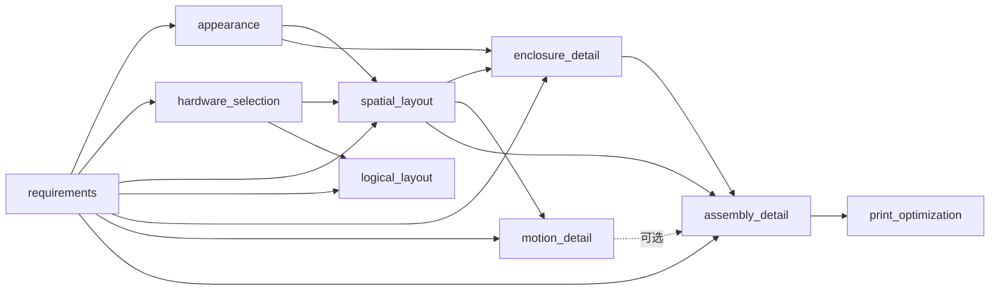

# Process：设计信息、上下文与流程产物

`process → engine → element`。process 负责明确任务输入、组织已有设计信息、校验依赖与接收 Agent 编写的产物；元件原生工程定义归 element，项目表达与检查归 engine，Agent/LLM 调用和持久化归宿主。

## 目录组织

每个主流程和底层操作各占一个目录，`__init__.py` 是可执行接口，`README.md` 是该流程的信息组织文档。主流程各自拥有请求类型、输出类型绑定、必需/可选上游和上下文键；公共契约和版本校验只实现一次。

```text
process/
  README.md                 架构、流程导航、使用方式
  CONTEXT.md                文件读取、LLM 上下文与输出映射的公共约定
  requirements/             以下九个目录：__init__.py + README.md
  appearance/
  hardware_selection/
  spatial_layout/
  logical_layout/
  enclosure_detail/
  motion_detail/
  assembly_detail/
  print_optimization/
  selection/                以下七个目录：原有底层操作 + README.md
  placement/
  connection/
  motion/
  mechanical_detail/
  circuit_detail/
  logic_detail/
  _workflow.py              主流程共用的 prepare/submit、依赖闭包、校验、视图
  workflows.py              兼容导出与九流程注册；SPECS 从各目录定义汇总
  artifacts.py              版本化产物与原生输出契约
  base.py / contracts.py    共用运行协议、检查和提案
  context.py / proposal.py  注入只读资源；构造候选设计
  registry.py / __main__.py 白名单分发与 CLI
  tests/                    回归测试和人工流程样例
```

原有 `from process import SpatialLayoutProcess`、`from process.workflows import SpatialLayoutProcess` 和 `from process.selection import SelectionProcess` 继续可用；也可以直接从 `process.spatial_layout` 导入主流程。

## 九个主流程

各目录文档分别给出：任务与信息源、Agent 上下文顺序、输出字段、案例文件目标、校验与能力边界。公共的来源/版本管理和接入设计见 [CONTEXT.md](CONTEXT.md)。

各流程 README 同时是执行 prompt：先应用 [共用执行规则](CONTEXT.md#各阶段共用的执行-prompt)，再执行该阶段的具体要求。文件任务的文档最小集与本次案例审计见 [examples 文档规则](DOCUMENTATION.md)；九流程代表能力与依赖，不要求每个项目预建九份空白说明。现有 Python 接口和产物字段保持各自契约。

| 流程文档 | 必需上游 | 主要结果 | 目录 v2 的文件目标（由宿主映射） |
| --- | --- | --- | --- |
| [需求与功能](requirements/README.md) | 原始 source_documents | requirements/functions 文档 | doc/requirements/ |
| [外观](appearance/README.md) | requirements | 图像资产与视角说明 | doc/appearance/ |
| [硬件选型](hardware_selection/README.md) | requirements + 元件库/嵌入定义 | 固定元件引用和实例清单 | element/index.json、元件包/库引用 |
| [空间布局](spatial_layout/README.md) | requirements、hardware_selection、appearance | 实例世界位姿 | design/structure.json |
| [电路逻辑布局](logical_layout/README.md) | requirements、hardware_selection | 网络与显式未连接端子 | design/circuit-logic.json、阶段说明 |
| [外壳深化](enclosure_detail/README.md) | requirements、spatial_layout、appearance | 带材料与位姿的 CAD 组件 | 定制元件包、索引、结构位姿 |
| [运动深化](motion_detail/README.md) | requirements、spatial_layout | 跨元件关节与范围、初值 | design/motion.json |
| [装配深化](assembly_detail/README.md) | requirements、spatial_layout、enclosure_detail | 深化组件与装配关系 | 元件包、motion/structure、阶段说明 |
| [打印优化](print_optimization/README.md) | assembly_detail + printer | 打印件、姿态、支撑与修改说明 | 派生元件资产、doc/print_optimization/ |

assembly_detail 可选依赖 motion_detail；引用运动关节时必须提供它。依赖是图，并非固定九步流水线。外观与选型可独立进行；电路逻辑不依赖空间布局；外壳和运动深化也可分别进行。



## 设计文件与产物协议

[examples/project_1](../examples/project_1/README.md) 使用项目目录 v2：project.json、element/、design/、doc/。`load_project` 解析为 layout_project；它不读取阶段文档正文或执行代码。

现有流程 Request 则接受八层 DesignPackage，上游是固定版本的 DesignArtifact。二者没有自动转换/写回接口。阶段文档的文件目标是宿主接入约定，不能把产物 JSON 直接写入同名项目文件。尤其需要区分项目短引用、ObjectRef、打印姿态与世界位姿，以及项目电路网络和行为程序。

读取完整对象优先复用 [engine.language](../engine/language/README.md) 与 [element.language](../element/language/README.md) 的结构化 Markdown。按流程保留相关资料、稳定引用、单位、证据和未知项；按需读取和预算裁剪策略详见公共协议。

## 运行接口

- `describe()`：真实 JSON Schema、依赖、上下文键、能力边界。
- `inspect(request, context)`：只读检查快照、缺失信息、版本、引用及输出契约。
- `run(action='prepare')`：返回 ContextPack，包含上游传递闭包、元件定义与约束。
- `run(action='submit')`：接收显式编写的 deliverable，返回 DesignArtifact 和绑定版本的视图数据。
- `run(action='generate')`：目前返回 unsupported，宿主需自行连接 Agent/模型执行器。

```python
from process import AppearanceInput, AppearanceRequest, AppearanceProcess, artifact_ref

# design 是有效 DesignPackage，requirements 是同一基线快照的需求 DesignArtifact。
request = AppearanceRequest.for_design(
    design,
    artifacts=(requirements,),
    input=AppearanceInput(
        action='prepare', artifact_id='appearance',
        upstream={'requirements': artifact_ref(requirements)},
    ),
)
result = AppearanceProcess().run(request)
# 宿主将 result.output.context 和阶段文档交给 Agent。
# 取得真实图像引用后，以 submit + AppearanceOutput 提交；不会自动保存文件。
```

引用为 `{artifact_id, revision, content_hash}`；请求必须带齐依赖闭包。禁止混用设计、快照、依赖版本或同一 ID 的多个版本；新 revision 需提供上一版精确 pin。宿主选择当前版本；process 不维护隐藏的 latest。

主流程 submit 不修改 DesignPackage，结果标记 `validation='contract_only'`。project_artifact 返回文档/图集/硬件表/场景等 JSON 视图，不新增编辑器。资产引用被接受不代表字节已读取或哈希核验。

## 七个底层操作

| 文档 | 已有能力 | 明确边界 |
| --- | --- | --- |
| [selection](selection/README.md) | 搜索、比较、选择/替换为 selection 记录 | 不自动采购，不把未知需求标为满足 |
| [placement](placement/README.md) | 显式世界/相对位姿 | 无自动布局求解器 |
| [connection](connection/README.md) | 跨元件挂点、网络、物料/信息/能量关系 | 不推断安装孔或改写本征拓扑 |
| [motion](motion/README.md) | 关节、传动、驱动和初值 | 无逆运动学求解器 |
| [mechanical_detail](mechanical_detail/README.md) | 准备条件、集成已编写 CADHousing | 无通用 CAD 生成、配合/强度验证 |
| [circuit_detail](circuit_detail/README.md) | 显式 wiring 网络 | 无 EDA/ERC/模拟电路/PCB 后端 |
| [logic_detail](logic_detail/README.md) | LogicData 行为与绑定、惰性程序/固件引用 | 不执行、不编译或刷写 |

底层修改返回 DesignProposal，经 `build_candidate` 检查基线、记录版本与写范围后得到候选；checks 绑定候选快照，宿主显式持久化。审批只在经过认证的应用路由中完成。

## 验证与执行证据

```powershell
.\python.cmd -m process list
.\python.cmd -m process schema spatial_layout
.\npm.cmd run check
.\npm.cmd test
.\npm.cmd run build
```

CLI 只分发注册的 kind，从 stdin 读取有界 JSON，不动态加载任意模块。completed 返回退出码 0，其他流程状态/无效输入返回 2。

[九阶段回归数据](tests/fixtures/design_pipeline.py) 使用人工编写的简单几何与图像引用演示闭包和产物，不生成图像、不优化实体。工程结论必须来自实际执行并绑定候选快照的检查；几何执行不等于制造成功，代码存储不等于固件编译成功。
